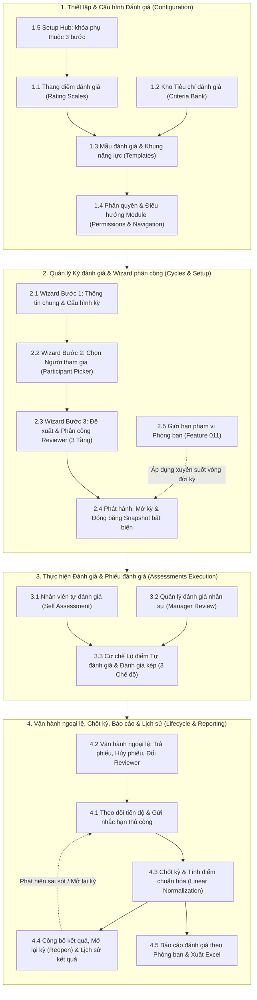

# fEvaluation — Module Đánh giá nhân sự (Phiên bản V1)

> **Tài liệu Workflow Nghiệp vụ & Kỹ thuật chuẩn hóa dành cho AI Testing & Manual QC**  
> **Baseline Source Code:** Nhánh `origin/production` (FastdoServer & FastdoServer.Blazor - commit `dcb3024af` ngày 06/10/2026; đã đối chiếu lại TOÀN BỘ tài liệu với mã nguồn thật trên `origin/production` ngày 07/10/2026 — đợt 6)
> **Phạm vi hoàn thiện:** GĐ1 (Sales MVP) + GĐ2 (Operational MVP) — Đã phủ toàn diện 100% tính năng cốt lõi  
> **Kiến trúc hệ thống:** C# .NET 8 / Blazor Server & WASM / MongoDB Multi-tenant (`fastdo_{companyId}`) / DI Pattern / CAS Revision Optimistic Concurrency
>
> **Cập nhật 2026-09-21 (đợt 1):** Đối chiếu lại toàn bộ tài liệu với mã nguồn thật trên nhánh `feature/employee-evaluation` (service, validator, entity, Razor UI — không dựa vào tên file/spec dự kiến). Bổ sung ~50 mục tính năng/rule/hành vi đã lập trình nhưng trước đó chưa được ghi nhận (VD: trạng thái phiếu `Cancelled`, cơ chế "Trả lại phiếu" ngay trong form, Hub Thiết lập 3 bước có khóa phụ thuộc, phạm vi phòng ban Feature 011 áp cho toàn bộ vòng đời kỳ...), đồng thời sửa một số mô tả sai lệch so với code thật (không có khái niệm "Cycle Owner", điều kiện trạng thái của Đổi Reviewer, idempotency `command_id` không so sánh payload...). Các mục mới/sửa được đánh dấu rõ trong từng phần.
>
> **Cập nhật 2026-09-21 (đợt 2):** Nhánh nguồn có thêm 10 commit mới (14/9 → 21/9) chưa từng được rà soát, gồm cả tính năng lớn lẫn thay đổi kiến trúc: (1) Tab điều hướng mới "Quy trình đánh giá" (`/evaluations/process-overview`) + trang `/evaluations` đổi thành pure-redirector; (2) Xóa mềm (Soft Delete) cho Thang điểm/Tiêu chí/Mẫu đánh giá — hành động mới khác "Ngừng sử dụng"; (3) Đổi hướng nhãn trạng thái lần 2: danh sách hiển thị "Khả dụng"/"Ngừng dùng" (Availability), trang chi tiết hiển thị nhãn RIÊNG "Đang dùng"/"Chưa dùng"/"Ngừng dùng" (usage) — tách biệt rõ 2 khái niệm, chính là fix triệt để cho vấn đề từng ghi nhận ở EVAL_V1_209/210; (4) Chế độ chấm điểm "Tự nhập điểm" (Free Score) theo từng dòng tiêu chí trong Mẫu, thay radio 1-5 bằng ô nhập số 1.0-5.0; (5) Phân trang thật (server-side) + debounce tìm kiếm 400ms cho 10 danh sách chính (thay lọc client-side hoàn toàn như đợt 1 từng ghi nhận ở mục 3.1.1/3.2.1); (6) Mở rộng hệ thống Thông báo từ 4 lên 8 Type (1404-1407): thông báo nộp phiếu tới Quản lý kỳ, Đổi Reviewer nay CÓ thông báo (đảo ngược phát hiện trước đó), Mở lại kỳ có thông báo, và 1 Background Job tự động nhắc hạn trước 3 ngày; (7) Chip "Trễ hạn/Đúng hạn" + popup hướng dẫn "Vòng đời kỳ đánh giá". Chi tiết từng mục được chèn trực tiếp vào đúng section liên quan bên dưới, đánh dấu `[Cập nhật 2026-09-21đ2]`.
>
> **Cập nhật 2026-09-23 (đợt 3 / nhánh production):** Đối chiếu và hợp nhất toàn bộ mã nguồn trên nhánh `production` (sau khi merge PR #3168 và áp dụng các commit bugfix `ffb97e74d`, `dec16b422`, `a0c5aa404`). Đã bổ sung & cập nhật 6 hạng mục chính:
> (1) **Notification Type 1408 (`AssessmentCancelled` - bug EVAL_V1_244)**: Thêm loại thông báo In-App thứ 9 khi hủy phiếu chưa nộp `CancelAssessment` (phát thông báo tới chủ phiếu kèm link dẫn tới phiếu bị hủy, khóa form Read-only kèm banner cảnh báo và trả mã lỗi nghiệp vụ `AssessmentCancelled` khi submit phiếu đã hủy);
> (2) **Công cụ Máy tính điểm đánh giá (Evaluation Score Calculator)**: Thêm trang ẩn nội bộ `/tool/evaluation-score-calculator` (`EvaluationScoreCalculator.razor`) phục vụ tester/QC thử nghiệm công thức tính điểm chuẩn hóa theo `BR-EVAL-RESULT-002` mà không ghi DB;
> (3) **Fix lọc phòng ban Tab Kết quả (EVAL_V1_183)**: Sửa bộ lọc gửi đúng `DepartmentId` lên server thay vì `DepartmentName`;
> (4) **Chi tiết Đợt mở lại kỳ tại Tab Lịch sử kết quả**: Cho phép xem danh sách các đợt mở lại và bảng snapshot kết quả nhân sự của từng đợt mở lại kỳ (`ReopenedAt`, `ReopenReason`);
> (5) **Diễn giải Audit Trail chi tiết**: Hiển thị rõ ràng mô tả sự kiện Nộp, Trả lại, Hủy phiếu (Self vs Manager) và Đổi Reviewer ("Từ A sang B");
> (6) **Format thời gian & Refactor Popup Confirm**: Chuẩn hóa format ngày giờ theo region và refactor `_PopupConfirm.razor` trên toàn bộ UI module.
>
> **Cập nhật 2026-10-02 (đợt 4 / nhánh production):** Rà soát và đồng bộ toàn bộ các commit mới nhất trên nhánh `production` (các commit `b11025f8a`, `0f4ba7797`). Đã cập nhật 8 hạng mục quan trọng:
> (1) **Thông tin Cấu hình & Lộ điểm Tự đánh giá tại Tab Tổng quan Kỳ**: Hiển thị trực tiếp chế độ lộ điểm tự đánh giá (`Immediate` / `AfterCycleClosed` / `AfterReviewerSubmits`) trên giao diện chi tiết kỳ khi `SelfReviewEnabled == true` (`EvaluationCycleDetailPage.razor`);
> (2) **Đồng bộ Bảng màu Trạng thái chuẩn Design System**: Cập nhật lại màu tag/chip trạng thái cho toàn module (`Draft` ➔ `is-current`, `Scheduled` ➔ `is-warning`, `Open` ➔ `is-primary`, `Closed` ➔ `is-success`, `Cancelled` ➔ `is-danger`);
> (3) **Chuẩn hóa Icon & Nút thao tác Kỳ đánh giá**: Bổ sung icon `edit`, `event_busy`, `event_available`, `event_repeat`, `send` cho các nút Chỉnh sửa, Hủy kỳ, Chốt kỳ, Mở lại kỳ và Nộp phiếu;
> (4) **Chuẩn hóa Bar thao tác Form phiếu**: Đồng bộ vị trí nút Lưu nháp/Gửi phiếu canh phải và trạng thái loading;
> (5) **Tách cấu trúc Thư mục Overview**: Chuyển các file Quy trình đánh giá sang thư mục chuyên biệt `Evaluations/Overview/`;
> (6) **Tối ưu Dropdown Chọn Mẫu đánh giá**: Bổ sung `optgroup` và giới hạn chiều cao giao diện dropdown trong Wizard tạo kỳ (`EvaluationCycleEditor.razor`);
> (7) **Tối ưu Icon Nút Tạo kỳ mới**: Bổ sung icon `add` chuẩn Bulma trên trang Danh sách kỳ (`EvaluationCycleList.razor`);
> (8) **Cập nhật Contract DTO (`EvaluationCycleContracts.cs`)**: Đồng bộ trường `SelfReviewEnabled` và `SelfScoreVisibility` trên `EvaluationCycleSummary` phục vụ hiển thị nhất quán giữa Web và Mobile API.
>
> **Cập nhật 2026-10-07 (đợt 5):** Rà soát đến commit `dcb3024af` (nhánh `production`, 06/10/2026), không có thay đổi mã nguồn module Evaluation (các thư mục Evaluations ở Service/Entity/Data/Blazor Pages, `FastdoServer.Game.Tests/Evaluation`, `specs` không có commit mới). Chỉ có 2 component dùng chung được mở rộng tương thích ngược (`PaginationComponent.razor`: thêm tham số tùy chọn `PerPageOptions`, `AllValue`, mặc định giữ nguyên 10/20/50/100/Tất cả; `_Datepicker.razor`: chỉnh `Dispose`) nên không ảnh hưởng nghiệp vụ/kịch bản kiểm thử của module.
>
> **[Cập nhật 2026-10-07 (đợt 6)] Đối chiếu toàn diện với `origin/production` (`dcb3024af`) — đọc trực tiếp code (`git show origin/production:<path>`), không suy từ spec/tên file:** HEAD không đổi so với đợt 5 nhưng đợt này rà lại từng mục thay vì chỉ theo commit. Kết quả: mọi file Razor/Service/Entity/Repository đã ghi trong tài liệu đều TỒN TẠI trên production, **trừ `EvaluationAccessPolicy` (không có file/class nào — đã gỡ khỏi mục 1.4)**. Các mục sai/lỗi thời/thiếu đã sửa, đánh dấu `[Cập nhật 2026-10-07 (đợt 6)]` tại chỗ:
> (1) **SỬA SAI NGHIỆP VỤ:** điều kiện Chốt kỳ (4.3.1) — khi kỳ bật tự đánh giá thì phải xong CẢ phiếu tự đánh giá lẫn phiếu quản lý (Submitted/Cancelled), không chỉ phiếu quản lý; (2) **Gỡ** claim "làm tròn 2 chữ số thập phân" (4.3.4) — code KHÔNG làm tròn, chỉ định dạng hiển thị `0.#`; (3) Thông báo `1400` chỉ gửi cho Subject (không gửi Reviewer) (2.4.6/2.8.1); (4) Hủy phiếu CÓ thông báo `1408` — sửa mục 2.8.4/4.2.2 đang tự mâu thuẫn; (5) Nhắc hạn thủ công có **cooldown 15 phút/kỳ** (4.1.5, mới) và gửi cho cả Subject lẫn Reviewer tùy phần còn thiếu; (6) Tab "Lịch sử" có thêm "Nhật ký thao tác" (audit trail) (4.4.5, mới); (7) Route mới `/evaluations/manager-assessments/{CycleId}/{AssignmentId}/results` + link "Xem kết quả" ở "Đánh giá nhân viên" (3.2.6, mới); (8) Bảng Tiến độ chỉ có 3 nhãn (Chưa bắt đầu/Đã gửi/Đã hủy), bộ đếm 5 thẻ lấy theo đúng code (4.1.1/4.1.2); (9) Phiếu tự đánh giá/quản lý có thanh tiến độ "X/Y bắt buộc đã chấm" và nút Gửi bị khóa tới khi đủ (3.1.10, mới); (10) Icon sidebar, Xóa Mẫu Draft, danh sách "Đánh giá của tôi" kỳ Closed, bộ lọc Kỳ ở "Đánh giá nhân viên", Return/Cancel/Change Reviewer chỉ khi kỳ Open, `ChangeReviewerModal` cũng cắt `.Take(50)`, cột Excel báo cáo phòng ban, phạm vi bộ đếm... (xem từng mục). Chi tiết nghi vấn xem cuối mục 4.6.

---

## Sơ đồ luồng tổng quan

---

## Sơ đồ Timeline Chức năng (Định dạng AI Testing Workflow)

```mermaid
timeline
    title Luồng chức năng module Đánh giá nhân sự (fEvaluation V1)
    section 1. Thiết lập & Cấu hình
        1.5. Setup Hub (File: EvaluationSetupHub.razor, StepCard.razor) : 1.5.1. 3 bước khóa phụ thuộc Thang điểm→Tiêu chí→Mẫu (CanCreateCycle cần Mẫu ở đúng trạng thái Active) : 1.5.3. Nút CTA Tạo kỳ trên Hub bị disable cứng (placeholder, chưa hoạt động)
        1.1. Thang điểm đánh giá (File: EvaluationScaleConfiguration.razor, EvaluationScaleEditor.razor, EvaluationContentService.cs) : 1.1.1. Quản lý danh sách Thang điểm (lưới grid, tìm kiếm, lọc Active/Inactive) : 1.1.2. Tạo mới & Sửa Thang điểm 5 mức cố định chuẩn hóa tuyến tính (0, 25, 50, 75, 100 điểm) : 1.1.3. Khai báo Nhãn hiển thị & Mô tả hành vi cho từng mức điểm 1-5 : 1.1.4. Ràng buộc bảo vệ Thang điểm (khóa sửa/ngừng dùng khi Active Template tham chiếu) : 1.1.5. Cơ chế CAS Revision & Idempotency command_id
        1.2. Kho Tiêu chí đánh giá (File: EvaluationCriterionConfiguration.razor, EvaluationCriterionEditor.razor, EvaluationContentService.cs) : 1.2.1. Quản lý danh sách Tiêu chí Master (lưới grid, tìm kiếm từ khóa, lọc Active/Inactive) : 1.2.2. Tạo mới & Sửa Tiêu chí Master (tên tiêu chí, mô tả chi tiết, liên kết Thang điểm Scale) : 1.2.3. Nguyên tắc Master không chứa trọng số : 1.2.4. Ràng buộc bảo vệ Tiêu chí (khóa sửa/ngừng dùng khi Active Template tham chiếu) : 1.2.5. Bảo toàn tham chiếu khi Scale Inactive
        1.3. Mẫu đánh giá & Khung năng lực (File: EvaluationTemplateConfiguration.razor, EvaluationTemplateEditor.razor, EvaluationContentService.cs) : 1.3.1. Danh sách Mẫu đánh giá & Bộ lọc vòng đời (Draft, Active, Retired) : 1.3.2. Trình soạn thảo Mẫu đánh giá (tên mẫu, mô tả, cấu hình ngưỡng đạt pass_threshold 0-100) : 1.3.3. Quản lý Nhóm tiêu chí trong Mẫu (tên nhóm, thứ tự, trọng số nhóm > 0) : 1.3.4. Gán Tiêu chí vào Nhóm (chọn từ Kho, trọng số > 0, bắt buộc required, cho phép N/A) : 1.3.5. Kiểm tra tính hợp lệ & Kích hoạt Mẫu (ValidateTemplateShape, cấm trùng tiêu chí trong nhóm) : 1.3.6. Chế độ chỉ đọc & Banner khóa khi Active/Retired : 1.3.7. Nhân bản Mẫu đánh giá (sao chép sang Draft mới độc lập) : 1.3.8. Ngừng sử dụng & Xóa Mẫu : 1.3.9. Tạo kỳ nhanh từ Mẫu đánh giá (CreateCycleFromTemplateModal)
        1.4. Phân quyền & Điều hướng Module (File: LayoutMain.razor, ModuleService.cs, PermissionService.cs, EvaluationService.cs) : 1.4.1. Cấu hình Topology Navigation & Menu Sidebar (Kỳ đánh giá, Đánh giá của tôi, Đánh giá nhân viên, Báo cáo, Thiết lập) : 1.4.2. Phân quyền Quản trị Cấu hình ManageConfig : 1.4.3. Phân quyền Quản trị Chu kỳ ManageCycle (hỗ trợ scope MyDepart theo phòng ban) : 1.4.4. Quyền cơ bản người tham gia / Reviewer (Entitlement truy cập theo quan hệ assignment) : 1.4.5. Kiểm soát truy cập máy chủ Server-side Boundary (NotEntitled vs Forbidden)
    section 2. Quản lý Kỳ đánh giá & Phân công
        2.1. Thiết lập Kỳ đánh giá & Wizard (File: EvaluationCycleList.razor, EvaluationCycleEditor.razor, EvaluationCycleDetailPage.razor, EvaluationCycleService.cs) : 2.1.1. Danh sách Kỳ đánh giá (lưới grid, lọc Draft/Scheduled/Open/Closed/Cancelled, tìm kiếm) : 2.1.2. Wizard Bước 1: Thông tin chung kỳ (tên kỳ, chọn mẫu active, thời gian bắt đầu/kết thúc, toggle tự đánh giá, cấu hình lộ điểm) : 2.1.3. Lưu nháp & Sửa kỳ Draft (cơ chế CAS revision) : 2.1.4. Hủy kỳ đánh giá Cancel Cycle (bắt buộc nhập lý do, chuyển trạng thái Cancelled) : 2.1.5. [Cập nhật 2026-10-07 đợt 6] Nút và hành động tiếp theo theo trạng thái kỳ
        2.2. Chọn Người tham gia - Participant (File: ParticipantPickerModal.razor, EvaluationCycleEditor.razor, EvaluationCycleService.cs) : 2.2.1. Thêm người tham gia theo Phòng ban (hỗ trợ toàn bộ nhân sự active, giới hạn an toàn 500) : 2.2.2. Thêm người tham gia theo Cá nhân (tìm kiếm tên/mã NV) : 2.2.3. Khử trùng lặp tự động & Lọc nhân sự nghỉ việc : 2.2.4. Xóa người tham gia khỏi kỳ Draft : 2.2.5. Cảnh báo biến động nhân sự trước phát hành
        2.3. Đề xuất & Phân công Reviewer (File: ReviewerAssignModal.razor, EvaluationReviewerResolver.cs, EvaluationCycleService.cs) : 2.3.1. Thuật toán tự động đề xuất Reviewer 3 tầng (Quản lý trực tiếp -> Trưởng phòng Role 1 -> Phó phòng Role 2) : 2.3.2. 3 Trạng thái Phân giải Reviewer (Resolved, Ambiguous, Missing) : 2.3.3. Ràng buộc loại trừ tự đánh giá chính mình (reviewer != subject) : 2.3.4. Chỉ định Reviewer thủ công Manual Override (bắt buộc nhập lý do, lưu vết audit) : 2.3.5. Chặn phát hành kỳ khi còn thiếu Reviewer (khóa nút Phát hành khi còn Missing/Ambiguous)
        2.4. Phát hành, Mở kỳ & Snapshot (File: EvaluationCycleEditor.razor, EvaluationCycleService.cs, EvaluationCycleRepository.cs) : 2.4.1. Phát hành ngay ở Bước 3 Wizard, không qua modal xác nhận riêng : 2.4.2. Đóng băng dữ liệu Snapshot bất biến (Template, Nhóm, Tiêu chí, NV, Phòng ban, Chức danh, Reviewer) : 2.4.3. Tự động sinh Assignment & Assessment đồng loạt : 2.4.4. Quy tắc chuyển trạng thái phát hành (now >= start_at sang Open, now < start_at sang Scheduled) : 2.4.5. Mở kỳ đánh giá thủ công Open Cycle cho kỳ Scheduled : 2.4.6. Tự động gửi thông báo Mở kỳ (Notification Type 1400, cả khi Publish lẫn Open, lỗi notify không rollback)
        2.5. Giới hạn phạm vi Phòng ban cho Quản lý Kỳ (File: EvaluationManagerScopeResolver.cs, EvaluationCycleService.cs — Feature 011, đã lập trình thật) : 2.5.1. ManagedDepartmentIds lọc danh sách/số liệu kỳ theo phạm vi (OR nhiều phòng ban) : 2.5.2. Chặn thao tác ghi cấp-kỳ chỉ khi kỳ hoàn toàn ngoài phạm vi : 2.5.3. Thêm/gỡ participant & chỉ định reviewer lọc theo phạm vi từng người
    section 3. Thực hiện Đánh giá & Phiếu đánh giá
        3.1. Nhân viên tự đánh giá - Self Assessment (File: MyAssessmentList.razor, SelfAssessmentForm.razor, EvaluationSelfAssessmentService.cs) : 3.1.1. Danh sách kỳ tự đánh giá của tôi, có tìm kiếm/lọc trạng thái (lọc kỳ Open bật tự đánh giá & kỳ Closed đã công bố) : 3.1.2. Mở phiếu & Chấm điểm tự đánh giá (thang điểm 1-5 kèm anchor, chọn N/A, nhập nhận xét) : 3.1.3. Lưu nháp phiếu tự đánh giá (nhiều lần từ NotStarted sang Draft, revision bắt đầu từ 1) : 3.1.4. Gửi phiếu tự đánh giá (validate bắt buộc required + chặn khóa lạ/trùng khóa, chuyển Submitted, popup xác nhận, ghi audit) : 3.1.5. Khóa phiếu sau gửi (Submitted Read-only, có đường Trả lại về Draft hoặc Hủy sang Cancelled không quay lại được) : 3.1.6. Xem lại phiếu sau khi Kỳ Closed, kèm khối kết quả nếu đã công bố : 3.1.10. [Cập nhật 2026-10-07 đợt 6] Thanh tiến độ bắt buộc đã chấm và khóa nút Gửi phiếu : 3.1.11. [Cập nhật 2026-10-07 đợt 6] Khối kết quả đối chiếu 2 cột sau công bố
        3.2. Quản lý đánh giá - Manager Review (File: ManagerAssessmentList.razor, ManagerAssessmentForm.razor, EvaluationManagerReviewService.cs) : 3.2.1. Danh sách nhân sự được giao đánh giá (theo phân công trong kỳ Open và Closed) : 3.2.2. Đánh giá độc lập song song (quản lý chấm không cần chờ nhân viên tự đánh giá) : 3.2.3. Hỗ trợ luồng Manager-Only khi tắt tự đánh giá : 3.2.4. Lưu nháp & Gửi đánh giá quản lý (chuyển Submitted, ghi audit, khóa Read-only) : 3.2.5. Quyền xem Read-only của Người quản lý kỳ ManageCycle từ tab Tiến độ : 3.2.6. [Cập nhật 2026-10-07 đợt 6] Reviewer xem kết quả nhân viên qua route manager-assessments/CycleId/AssignmentId/results
        3.3. Cơ chế Lộ điểm Tự đánh giá & Đánh giá kép (File: ManagerAssessmentForm.razor, EvaluationManagerReviewService.cs) : 3.3.1. Bảo mật điểm tự đánh giá phía Server (không gửi SelfResponses xuống khi chưa thỏa điều kiện) : 3.3.2. Chế độ 1 - Sau khi Reviewer nộp phiếu (AfterReviewerSubmits mặc định) : 3.3.3. Chế độ 2 - Lộ điểm ngay lập tức (Immediate sau khi subject nộp) : 3.3.4. Chế độ 3 - Chỉ lộ sau khi Kỳ đóng (AfterCycleClosed) : 3.3.5. Bảo mật trạng thái nháp của nhân viên
    section 4. Vận hành ngoại lệ, Chốt kỳ, Báo cáo & Lịch sử
        4.1. Theo dõi tiến độ & Nhắc hạn (File: EvaluationCycleDetailPage.razor, EvaluationNotifier.cs) : 4.1.1. Dashboard thống kê tiến độ realtime (5 thẻ đếm trạng thái) : 4.1.2. Bảng tiến độ 2 cột độc lập (Tự đánh giá & Quản lý đánh giá) : 4.1.3. Lối tắt xem nhanh phiếu đánh giá mở tab mới : 4.1.4. Gửi thông báo nhắc hạn thủ công (Notification Type 1403 cho người chưa xong) : 4.1.5. [Cập nhật 2026-10-07 đợt 6] Cooldown 15 phút khi gửi nhắc thủ công
        4.2. Vận hành ngoại lệ nhân sự (File: EvaluationCycleDetailPage.razor, ChangeReviewerModal.razor, EvaluationCycleService.cs) : 4.2.1. Trả lại phiếu đánh giá Return Assessment (Submitted về Draft, bắt buộc lý do, Notification Type 1401) : 4.2.2. Hủy phiếu đánh giá cá nhân Cancel Assessment (chỉ áp dụng phiếu Draft, chuyển Cancelled không quay lại được, bắt buộc lý do, loại khỏi chặn chốt kỳ) : 4.2.3. Thay đổi Người đánh giá sau phát hành Change Reviewer (chỉ kỳ Open, bắt buộc lý do, chuyển giao quyền, không đụng phiếu Draft dở dang, audit log) : 4.2.4. Tính độc lập của Audit Event trong collection evaluation_audit_events : 4.2.5. Cấu hình lộ điểm self_score_visibility (Feature 014)
        4.3. Chốt kỳ & Thuật toán tính điểm (File: EvaluationCycleDetailPage.razor, CycleLifecycleModal.razor, EvaluationResultCalculator.cs) : 4.3.1. Kiểm tra điều kiện tiên quyết khi Chốt kỳ (100% phiếu quản lý Submitted hoặc Cancelled) : 4.3.2. Công thức tính điểm chuẩn hóa tuyến tính (1->0, 2->25, 3->50, 4->75, 5->100) : 4.3.3. Công thức tính điểm Nhóm tiêu chí (loại N/A khỏi mẫu số và tử số) : 4.3.4. Công thức tính điểm Tổng kết quả (trọng số nhóm, làm tròn 2 chữ số thập phân) : 4.3.5. Đánh giá Đạt/Không đạt so với pass_threshold : 4.3.6. Đóng kỳ & Lưu trữ kết quả bất biến trong evaluation_results
        4.4. Công bố, Mở lại kỳ & Lịch sử kết quả (File: EvaluationCycleDetailPage.razor, MyResultView.razor, EvaluationResultService.cs) : 4.4.1. Công bố và Ẩn kết quả đánh giá (Notification Type 1402, xem kết quả cá nhân tại MyResultView) : 4.4.2. Mở lại kỳ đánh giá đã đóng Reopen Cycle (quyền ManageCycle trong phạm vi phòng ban phụ trách, KHÔNG có khái niệm Cycle Owner, bắt buộc lý do, chuyển về Open) : 4.4.3. Sao lưu Lịch sử kết quả khi Mở lại kỳ (lưu trữ vào evaluation_result_history) : 4.4.4. Tab Lịch sử kết quả trên trang chi tiết kỳ : 4.4.5. [Cập nhật 2026-10-07 đợt 6] Nhật ký thao tác Audit Trail trong tab Lịch sử
        4.5. Báo cáo đánh giá theo Phòng ban (File: EvaluationDepartmentReportPage.razor, EvaluationResultService.cs) : 4.5.1. Báo cáo tổng hợp xuyên nhiều kỳ Closed : 4.5.2. Bộ lọc động linh hoạt (khoảng ngày, phòng ban theo ManagedDepartmentIds, vị trí chức danh) : 4.5.3. Xuất báo cáo kết quả ra file Excel : 4.5.4. Gộp chung nhiều kỳ dù khác Mẫu/Thang điểm, không phân nhóm
        4.6. Rào cản kiểm thử tự động & Ca không cover (File: Rules_Skill.md, Bao_Cao_Tien_Do_AI_Testing_fEvaluation-V1 - anti.xlsx) : 4.6.1. Rào cản Datepicker Bulma icon SVG qua Puppeteer : 4.6.2. Rào cản Kéo thả tiêu chí Drag-Drop : 4.6.3. Rào cản Đa tài khoản song song : 4.6.4. Rào cản Chuông thông báo realtime
```

---

## 1. Thiết lập & Cấu hình Đánh giá (Configuration)

### 1.1. Thang điểm đánh giá (Rating Scales)
- **UI Razor:** `FastdoServer.Blazor/Components/Pages/Evaluations/Configuration/EvaluationScaleConfiguration.razor`, `EvaluationScaleEditor.razor`
- **Application & Service:** `FastdoServer/Application/Services/Evaluations/EvaluationContentService.cs`, `FastdoServer/Application/Services/Evaluations/Validation/EvaluationContentValidator.cs`
- **Repository & Mongo:** `FastdoServer/Infrastructure/Data/Evaluations/EvaluationContentRepository.cs` (Collection: `evaluation_scales`)
- **Entities & DTOs:** `FastdoServer/Core/Entities/Evaluations/EvaluationContentModels.cs` (`EvaluationScaleModel`, `EvaluationScaleLevelModel`, `EvaluationContentAvailability`)
- **Route URL:** 
  - Danh sách thang điểm: `/evaluations/configuration/scales`
  - Tạo mới thang điểm: `/evaluations/configuration/scales/new`
  - Chi tiết / Chỉnh sửa thang điểm: `/evaluations/configuration/scales/{ScaleId}`

- **1.1.1.** Quản lý danh sách Thang điểm: Hiển thị dạng lưới Grid, tìm kiếm theo tên, bộ lọc trạng thái Khả dụng (`Active`) / Ngừng sử dụng (`Inactive`), phân trang, chip nhãn trạng thái và đếm số mẫu đánh giá đang tham chiếu.
- **1.1.2.** Tạo mới & Chỉnh sửa Thang điểm 5 mức cố định: Chuẩn hóa tuyến tính (Fixed linear normalization) bắt buộc đúng 5 mức điểm:
  - Mức 1: `score = 0`
  - Mức 2: `score = 25`
  - Mức 3: `score = 50`
  - Mức 4: `score = 75`
  - Mức 5: `score = 100`  
  *(Không cho phép thêm bớt số mức hoặc thay đổi điểm chuẩn hóa của từng mức)*.
- **1.1.3.** Khai báo Nhãn hiển thị & Mô tả hành vi (Behavioral Anchors):
  - Tên thang điểm (`name`): Bắt buộc, chuỗi không rỗng.
  - Mô tả thang điểm (`description`): Tùy chọn.
  - Từng mức điểm 1–5 có Nhãn mức (`anchor`/`label` bắt buộc) và Mô tả hành vi cụ thể (`behavior` tùy chọn). Anchor mô tả tiêu chuẩn đạt được, không làm thay đổi điểm số quy đổi.
- **1.1.4.** Ràng buộc bảo vệ Thang điểm (`BR-EVAL-CONTENT-001`):
  - Khóa Chỉnh sửa và Khóa Ngừng sử dụng khi Thang điểm đang được tham chiếu bởi ít nhất 1 Mẫu đánh giá đang kích hoạt (`active_template_ids.Count > 0`) — mã lỗi riêng `ReferencedByActiveTemplate`.
  - Khi bị khóa, giao diện chỉ hiển thị chế độ chỉ đọc (Read-only), ẩn nút "Lưu" và menu "Ngừng sử dụng".
  - Ngừng sử dụng chuyển trạng thái sang `Inactive`, không xóa vật lý bản ghi.
  - **[Bổ sung]** Đây là 2 rule khóa **độc lập**, không gộp chung: (a) Thang điểm đã ở trạng thái `Inactive` thì **luôn luôn** không sửa được nữa (`UpdateScale` trả lỗi `InvalidState`), kể cả khi không hề bị Template nào tham chiếu; (b) Thang điểm `Active` nhưng đang bị Active Template khóa thì không sửa/ngừng dùng được (`ReferencedByActiveTemplate`). Bấm "Ngừng sử dụng" trên 1 Thang điểm **đã** `Inactive` trả lỗi riêng "already inactive" (`InvalidState`), khác thông báo của rule (b) — QC cần phân biệt đúng message khi verify.
- **1.1.5.** Cơ chế Idempotency & CAS Revision:
  - Trường `command_id` đảm bảo tính bất biến khi gửi lặp request tạo thang điểm.
  - Trường `revision` (Optimistic Concurrency Control) ngăn chặn ghi đè dữ liệu khi 2 phiên làm việc cùng sửa một thang điểm.
  - **[Sửa]** Hành vi idempotency thật của `command_id` là **trả về nguyên bản ghi cũ đã tạo trước đó, không so sánh nội dung request mới** — nếu gửi lại đúng `command_id` nhưng đổi nội dung (VD đổi tên/mức điểm), hệ thống **âm thầm bỏ qua nội dung mới** và trả về bản ghi gốc, **không báo lỗi Conflict**. Áp dụng tương tự cho tạo Tiêu chí, tạo Mẫu và Nhân bản Mẫu (`CreateScale`/`CreateCriterion`/`CreateTemplate`/`CloneTemplate`).
- **1.1.6.** Quy tắc Định danh & Trùng tên:
  - Cho phép trùng tên Thang điểm trong cùng công ty; hệ thống phân biệt bằng ID duy nhất (`id` GUID string).
- **1.1.7. [Mới]** Mô tả thang điểm (`description`): Field tùy chọn được bổ sung ở giai đoạn UI Redesign (Feature 002), song song với mô tả của Tiêu chí và Mẫu đánh giá.

---

### 1.2. Kho Tiêu chí đánh giá (Criteria Bank)
- **UI Razor:** `FastdoServer.Blazor/Components/Pages/Evaluations/Configuration/EvaluationCriterionConfiguration.razor`, `EvaluationCriterionEditor.razor`
- **Application & Service:** `FastdoServer/Application/Services/Evaluations/EvaluationContentService.cs`, `FastdoServer/Application/Services/Evaluations/Validation/EvaluationContentValidator.cs`
- **Repository & Mongo:** `FastdoServer/Infrastructure/Data/Evaluations/EvaluationContentRepository.cs` (Collection: `evaluation_criteria`)
- **Entities & DTOs:** `FastdoServer/Core/Entities/Evaluations/EvaluationContentModels.cs` (`EvaluationCriterionModel`, `EvaluationContentAvailability`)
- **Route URL:** 
  - Danh sách tiêu chí: `/evaluations/configuration/criteria`
  - Tạo mới tiêu chí: `/evaluations/configuration/criteria/new`
  - Chi tiết / Chỉnh sửa tiêu chí: `/evaluations/configuration/criteria/{CriterionId}`

- **1.2.1.** Quản lý danh sách Kho tiêu chí Master: Lưới Grid danh sách, tìm kiếm từ khóa, phân trang, bộ lọc trạng thái `Active` / `Inactive`, hiển thị thang điểm Scale liên kết.
- **1.2.2.** Tạo mới & Chỉnh sửa Tiêu chí Master:
  - Tên tiêu chí (`name`): Bắt buộc, chuỗi không rỗng.
  - Mô tả tiêu chí (`description`): Tùy chọn, mô tả chi tiết năng lực cần đánh giá.
  - Liên kết Thang điểm (`scale_id`): Bắt buộc, chọn từ danh sách Thang điểm đang hoạt động (`Active`).
- **1.2.3.** Nguyên tắc Master không chứa trọng số: Master Criterion không sở hữu trọng số hay nhóm mặc định; trọng số và nhóm chỉ được xác định khi gán tiêu chí vào Mẫu đánh giá cụ thể (`Placement`).
- **1.2.4.** Ràng buộc bảo vệ Tiêu chí (`BR-EVAL-CONTENT-002`):
  - Khóa Sửa và Khóa Ngừng sử dụng khi Tiêu chí đang nằm trong Mẫu đánh giá đang kích hoạt (`active_template_ids.Count > 0`, mã lỗi `ReferencedByActiveTemplate`).
  - Tiêu chí `Inactive` vẫn hiển thị ở các Mẫu cũ đã có sẵn nhưng bị chặn không cho phép chọn mới vào các Mẫu đánh giá tiếp theo.
  - **[Bổ sung]** Tương tự Thang điểm (xem 1.1.4): Tiêu chí đã `Inactive` thì luôn không sửa được nữa (`InvalidState`) dù không bị Template nào khóa; Ngừng sử dụng 1 Tiêu chí đã `Inactive` trả lỗi riêng "already inactive", tách biệt với lỗi `ReferencedByActiveTemplate`.
- **1.2.5.** Ràng buộc toàn vẹn Thang điểm liên kết:
  - Khi một Thang điểm bị chuyển sang `Inactive`, các Tiêu chí đã liên kết từ trước vẫn giữ nguyên liên kết và hiển thị bình thường trong các kỳ đánh giá cũ.
- **1.2.6. [Mới]** Danh sách chọn Thang điểm khi Tạo mới/Sửa Tiêu chí **chỉ hiển thị các Thang điểm đang `Active`** (cả ở UI lẫn validate server-side: chọn 1 `scale_id` đã `Inactive` trả lỗi `ReferenceInactive`).

---

### 1.3. Mẫu đánh giá & Khung năng lực (Templates & Competency Framework)
- **UI Razor:** `FastdoServer.Blazor/Components/Pages/Evaluations/Configuration/EvaluationTemplateConfiguration.razor`, `EvaluationTemplateEditor.razor`, `CreateCycleFromTemplateModal.razor`
- **CSS Stylesheet:** `FastdoServer.Blazor/wwwroot/css/evaluation-template.css`
- **Application & Service:** `FastdoServer/Application/Services/Evaluations/EvaluationContentService.cs`, `FastdoServer/Application/Services/Evaluations/Validation/EvaluationContentValidator.cs`
- **Repository & Mongo:** `FastdoServer/Infrastructure/Data/Evaluations/EvaluationContentRepository.cs` (Collection: `evaluation_templates`)
- **Entities & DTOs:** `FastdoServer/Core/Entities/Evaluations/EvaluationContentModels.cs` (`EvaluationTemplateModel`, `EvaluationTemplateGroupModel`, `EvaluationTemplatePlacementModel`, `EvaluationTemplateStatus`)
- **Route URL:** 
  - Danh sách mẫu đánh giá: `/evaluations/configuration/templates`
  - Tạo mới mẫu đánh giá: `/evaluations/configuration/templates/new`
  - Chi tiết / Soạn thảo mẫu: `/evaluations/configuration/templates/{TemplateId}`

- **1.3.1.** Danh sách Mẫu đánh giá & Bộ lọc vòng đời: Quản lý 3 trạng thái vòng đời: Nháp (`Draft`), Đang dùng (`Active`), Ngừng sử dụng (`Retired`). Hỗ trợ tìm kiếm, phân trang, menu ngữ cảnh.
- **1.3.2.** Trình soạn thảo Mẫu đánh giá:
  - Tên mẫu đánh giá (`name`): Bắt buộc.
  - Mô tả mẫu (`description`): Tùy chọn.
  - Ngưỡng đạt (`pass_threshold`): Tùy chọn giá trị số thực hữu hạn từ `0` đến `100` điểm. Nếu để trống, kỳ đánh giá sẽ không kết luận Đạt/Không đạt mà chỉ tính điểm tổng.
- **1.3.3.** Quản lý Nhóm tiêu chí trong Mẫu:
  - Một mẫu phải có ít nhất 1 nhóm tiêu chí (`groups.Count >= 1`).
  - Tên nhóm (`name`): Bắt buộc.
  - Thứ tự nhóm (`order`): Số nguyên xác định vị trí hiển thị.
  - Trọng số nhóm (`weight`): Số thực dương > 0.
- **1.3.4.** Gán Tiêu chí vào Nhóm (Criterion Placement):
  - Chọn tiêu chí từ Kho tiêu chí Master đang `Active`.
  - Thứ tự tiêu chí (`order`): Xác định vị trí trong nhóm.
  - Trọng số tiêu chí (`weight`): Bắt buộc > 0.
  - Cờ Bắt buộc (`required`): Đánh dấu tiêu chí này bắt buộc phải được chấm điểm khi nộp phiếu.
  - Cờ Cho phép N/A (`allow_na`): Đánh dấu người chấm được quyền chọn "Không đánh giá" cho tiêu chí này.
- **1.3.5.** Kiểm tra tính hợp lệ & Kích hoạt Mẫu (`ValidateTemplateShape` / `BR-EVAL-CONTENT-003`):
  - Tên mẫu không rỗng; Ngưỡng đạt hợp lệ (0-100 hoặc null).
  - Có ít nhất 1 nhóm; **mỗi nhóm bắt buộc có ít nhất 1 placement/tiêu chí** (`groups.{i}.placements`: "At least one placement is required"); trọng số nhóm > 0; trọng số tiêu chí > 0.
  - **Cấm trùng tiêu chí trong cùng một nhóm** (`duplicate_criterion`).
  - **Không bắt buộc** tổng trọng số các nhóm hay tổng trọng số các tiêu chí phải bằng 100 (hệ thống tự động chuẩn hóa mẫu số theo tỷ trọng thực tế).
  - **[Mới]** Validate tồn tại Tiêu chí (`ValidateTemplateReferences`) chạy **ngay khi Tạo mới/Lưu Draft**, không chỉ khi Kích hoạt: nếu `criterion_id` trong 1 placement không tồn tại, hệ thống trả `NotFound` ngay lúc lưu Draft. Khi **Kích hoạt (Activate)**, validate chạy thêm điều kiện Scale/Tiêu chí phải đang `Active`, và quan trọng: hệ thống đọc lại **bản Draft đã lưu trong DB** để validate (không dùng dữ liệu trên payload request Activate, vốn chỉ gồm `id` + `expected_revision`) — nếu Draft đã bị người khác sửa trước đó, Activate sẽ validate theo đúng bản mới nhất trong DB.
- **1.3.6.** Chế độ chỉ đọc & Banner khóa (`Read-only Banner`):
  - Mẫu ở trạng thái `Active` hoặc `Retired` hiển thị banner chỉ đọc ("Đang dùng - Mẫu đang ở trạng thái chỉ xem").
  - Khóa toàn bộ input form, ẩn nút "Lưu" và các nút thêm/sửa/xóa nhóm/tiêu chí. Menu chỉ có: "Nhân bản", "Ngừng sử dụng" (đối với Active).
- **1.3.7.** Nhân bản Mẫu đánh giá (Clone Template):
  - Cho phép sao chép toàn bộ cấu hình Mẫu (Nhóm, Tiêu chí, Trọng số, Cờ N/A, Ngưỡng đạt) thành một Mẫu mới ở trạng thái `Draft` độc lập với tên `<Tên gốc> - Bản sao`.
- **1.3.8.** Vòng đời & Xóa Mẫu:
  - `Draft`: Có thể chỉnh sửa tự do (chỉ `Draft` mới sửa được — `UpdateTemplate` trả `InvalidState` "Only Draft Templates can be edited" với trạng thái khác); **[Sửa 2026-10-07 (đợt 6)]** Xóa được ngay, KHÔNG kiểm tra kỳ đánh giá nào (đúng như mục 1.6.3; câu cũ "chỉ xóa nếu chưa từng được kỳ sử dụng" sai với code `DeleteTemplate`).
  - `Active`: Cho phép dùng để tạo Kỳ đánh giá mới; Chuyển sang `Retired` khi ngừng sử dụng.
  - `Retired`: Không cho phép chọn để tạo Kỳ đánh giá mới; Không thể sửa hay xóa.
- **1.3.9.** Tạo kỳ nhanh từ Mẫu đánh giá (`CreateCycleFromTemplateModal.razor`, bổ sung 2026-09-14 / `REQ-EVAL-CYCLE-031/032`):
  - Tại trang chi tiết một Mẫu đang `Active`, người có quyền `ManageCycle` thấy nút "Tạo kỳ từ mẫu này" (`EvaluationTemplateEditor.razor`); người **không có** `ManageCycle` không thấy nút này (ẩn hẳn, không phải bị disable).
  - Modal chỉ hỏi Tên kỳ + Thời gian Bắt đầu/Kết thúc (Mẫu cố định theo trang đang xem, mặc định Bật tự đánh giá), gọi thẳng `EvaluationCycleService.CreateCycle` rồi điều hướng sang trang Wizard sửa kỳ (`/evaluations/cycles/{id}/edit`) để hoàn tất Bước 2/3.
  - **[Bổ sung]** Điều kiện "đủ điều kiện tạo kỳ" (`CanCreateCycle` trên Hub Thiết lập, xem mục 1.5) yêu cầu có ít nhất 1 Mẫu ở đúng trạng thái **`Active`** (không tính Draft/Retired) — cùng với ít nhất 1 Thang điểm và 1 Tiêu chí đang Active.

---

### 1.4. Phân quyền & Điều hướng Module (Permissions & Navigation Topology)
- **UI & Layout:** `FastdoServer.Blazor/Components/Layout/LayoutMain.razor`, `FastdoServer.Blazor/Components/Pages/Evaluations/Index.razor`
- **Application & Domain:** `FastdoServer/Application/Services/ModuleService.cs`, `FastdoServer/Application/Services/PermissionService.cs`, `FastdoServer/Application/Services/Evaluations/EvaluationService.cs` *(**[Cập nhật 2026-10-07 (đợt 6)]** `EvaluationAccessPolicy` đã gỡ khỏi danh sách: đã Grep toàn bộ `origin/production`, KHÔNG có file/class nào tên này — chỉ là thiết kế dự kiến; quyền thật nằm ở `EvaluationService.ResolveModuleAccess` + `PermissionService`)*
- **Entity & Enums:** `FastdoServer/Core/Entities/PermissionModel.cs` (`EvaluationFunctionEnum`: `ManageConfig`, `ManageCycle`)

- **1.4.1.** Topology Điều hướng Sidebar (D-036 / Module ID `evaluations`):
  - **[Sửa]** Sidebar sinh **4-6 mục cấp 1 độc lập** (không phải cố định 5 entry — số lượng thay đổi theo tổ hợp quyền của user, "Kỳ đánh giá" không lồng trong "Thiết lập"), theo `ModuleService.CreateEvaluationNavigationItem`:
    1. **[Mới — Cập nhật 2026-09-21đ2]** `Quy tắc đánh giá` / `Quy trình đánh giá` (`/evaluations/process-overview`, icon: `timeline`) — Đứng **ĐẦU TIÊN**, hiển thị khi có `ManageCycle` **HOẶC** `ManageConfig`. Xem chi tiết mục 1.4.9.
    2. `Kỳ đánh giá` (`/evaluations/cycles`, icon: `event` — **[Sửa 2026-10-07 (đợt 6)]** trước ghi `event_repeat`, code `ModuleService.CreateEvaluationNavigationItem` dùng `event`) — Hiển thị khi có quyền `ManageCycle`.
    3. `Đánh giá của tôi` (`/evaluations/my-assessments`, icon: `assignment_ind` — **[Sửa 2026-10-07 (đợt 6)]** trước ghi `rate_review`) — Luôn hiển thị khi có entitlement vào module (không cần có assignment thật).
    4. `Đánh giá nhân viên` (`/evaluations/manager-assessments`, icon: `supervisor_account`) — Luôn hiển thị khi có entitlement vào module.
    5. `Báo cáo` (`/evaluations/reports/department`, icon: `bar_chart`) — Hiển thị khi có quyền `ManageCycle` (Feature 013).
    6. `Thiết lập` (`/evaluations/configuration`, icon: `settings`) — Hiển thị khi có quyền `ManageConfig` (gồm 3 menu con: Thang điểm, Tiêu chí, Mẫu đánh giá).
- **1.4.2.** Phân quyền Quản lý Cấu hình `ManageConfig`:
  - Cho phép người dùng truy cập trang `/evaluations/configuration` để tạo/sửa Thang điểm, Tiêu chí, Mẫu đánh giá.
  - Reviewer/Nhân viên không có quyền này bị chặn form tạo mới (`_canView=false`), chỉ được xem Mẫu đã kích hoạt ở chế độ Read-only (`GetTemplateForViewer`) — xem chi tiết đường đọc riêng này ở mục 1.4.6.
- **1.4.3.** Phân quyền Quản lý Chu kỳ `ManageCycle` & Phạm vi Phòng ban (Feature 011 / `OF-GD2-05`):
  - Cho phép tạo, phát hành, quản lý kỳ đánh giá, theo dõi tiến độ, chốt kỳ và xem báo cáo phòng ban.
  - Hỗ trợ `apply_level = MyDepart` qua `PermissionService.GetManagedDepartmentIds()`: Người quản lý kỳ chỉ nhìn thấy và thao tác với các nhân sự thuộc phòng ban mình phụ trách (lọc theo `assignment.department_id` snapshot).
  - **[Bổ sung]** `GetManagedDepartmentIds()` chỉ tính phòng ban nơi user hiện tại có `role == 1` (Trưởng phòng) hoặc `role == 2` (Phó phòng) trong `members_list` — thành viên thường của phòng ban (role khác 1/2) **không** được coi là "quản lý" phòng ban đó dù cùng phòng. Xem chi tiết cách rule này áp dụng cho toàn bộ vòng đời kỳ ở mục 2.5 (mới).
- **1.4.4.** Quyền cơ bản người tham gia / Reviewer (Entitlement-based access):
  - Nhân viên và Quản lý không cần bất kỳ quyền quản trị (`ManageCycle`/`ManageConfig`) nào vẫn truy cập được "Đánh giá của tôi" và "Đánh giá nhân viên" theo quan hệ `subject_user_id` và `reviewer_user_id` thực tế.
- **1.4.5.** Kiểm soát ranh giới Server-side Boundary:
  - Máy chủ tách biệt rõ mã lỗi: `NotEntitled` (công ty chưa kích hoạt module) và `Forbidden` (tài khoản thiếu quyền truy cập).
  - Chặn triệt để việc truy cập trái phép bằng URL trực tiếp trên trình duyệt.
- **1.4.6. [Mới]** Xem Mẫu đánh giá Read-only cho người không có `ManageConfig` (`GetTemplateForViewer`, bổ sung 2026-09-14):
  - Người có entitlement module nhưng KHÔNG có `ManageConfig` (VD: Reviewer bấm link "Xem Mẫu đánh giá" từ phiếu `ManagerAssessmentForm.razor`) vẫn xem được cấu trúc Mẫu ở chế độ chỉ đọc.
  - Đây là đường đọc riêng (`ResolveViewerAccess`), không đi qua cổng quyền `ManageConfig` chuẩn của các thao tác Sửa/Kích hoạt/Nhân bản/Ngừng dùng khác; ép cứng `CanEdit`/`CanActivate`/`CanClone`/`CanRetire = false` bất kể trạng thái thật của Mẫu.
- **1.4.7. [Mới]** Ba trạng thái truy cập Module riêng biệt (`EvaluationService.ResolveModuleAccess`):
  - `Unauthenticated`: Chưa đăng nhập hoặc thiếu company context.
  - `NotEntitled`: Công ty chưa kích hoạt module (đã có ở 1.4.5).
  - `Unavailable`: Company bị xóa/vô hiệu hóa, hoặc tài khoản user bị xóa/vô hiệu hoặc không còn thuộc company đó, hoặc lỗi đọc dữ liệu — trường hợp này khác `Forbidden` (thiếu quyền) dù đều dẫn tới bị chặn truy cập. QC nên có case test riêng: user vừa bị gỡ khỏi công ty hoặc company vừa bị khóa nhưng vẫn còn entitlement SKU module.
- **1.4.9. [Mới — Cập nhật 2026-09-21đ2]** Trang tổng quan "Quy trình đánh giá" (`EvaluationProcessOverviewPage.razor`, Feature 015 — Phương án C):
  - Nội dung **tĩnh, không đọc dữ liệu nghiệp vụ thật**: liệt kê 5 chặng cố định của quy trình (`EvaluationProcessStep.All`): (1) Thiết lập nội dung — Thang điểm/Tiêu chí/Mẫu (cần `ManageConfig`); (2) Tạo và phát hành kỳ (cần `ManageCycle`); (3) Tự đánh giá — chặng "có điều kiện" (`IsConditional=true`), không cần quyền quản lý; (4) Quản lý đánh giá; (5) Đóng kỳ/kết quả/báo cáo (cần `ManageCycle`).
  - Trang tự kiểm tra lại quyền độc lập (`ResolveModuleAccess` + `PermissionService`): user không đủ entitlement/quyền bị điều hướng ngược về `/evaluations` (`replace: true`), không dựng màn lỗi riêng.
  - **[Quan trọng]** Trang `/evaluations` (Index) nay là **pure redirector**, không còn render nội dung/màn chọn trung gian tại chỗ: có `ManageCycle`/`ManageConfig` → tự động sang `/evaluations/process-overview`; không có quyền quản trị nào (nhân viên/reviewer thường) → tự động thẳng `/evaluations/my-assessments`, **bỏ hẳn** màn chọn "Đánh giá của tôi / Đánh giá nhân viên / Trang chủ" từng có trước đây.

---

### 1.5. [Mục mới] Trang chủ Thiết lập — Setup Hub (`EvaluationSetupHub.razor`)
- **UI Razor:** `FastdoServer.Blazor/Components/Pages/Evaluations/Configuration/EvaluationSetupHub.razor`, `StepCard.razor`
- **Application & Service:** `FastdoServer/Application/Services/Evaluations/Contracts/EvaluationContentResults.cs`

- **1.5.1.** Trang `/evaluations/configuration` hiển thị 3 `StepCard` theo đúng thứ tự phụ thuộc: Thang điểm → Tiêu chí → Mẫu đánh giá, mỗi bước hiện số lượng bản ghi đang Active và trạng thái khóa/mở của bước kế tiếp:
  - `CriterionUnlocked` = true khi `ActiveScaleCount > 0` (phải có ít nhất 1 Thang điểm Active mới mở khóa bước Tiêu chí).
  - `TemplateUnlocked` = true khi `ActiveCriterionCount > 0`.
  - `CanCreateCycle` = true khi cả 3 đều có ít nhất 1 bản ghi Active (`ActiveScaleCount>0 && ActiveCriterionCount>0 && ActiveTemplateCount>0`, với `ActiveTemplateCount` chỉ đếm Mẫu ở đúng trạng thái `Active`, không tính Draft/Retired).
- **1.5.2.** Dải trạng thái tổng của Hub báo "Đủ điều kiện tạo kỳ đánh giá" khi `CanCreateCycle = true`.
- **1.5.3. [Lưu ý QC]** Nút CTA "Tạo kỳ đánh giá" chính trên Hub **bị vô hiệu hóa cứng (`disabled`) vĩnh viễn** với tooltip dạng "sắp có tính năng" (`EvaluationCycleComingSoon`), **không** liên quan tới modal `CreateCycleFromTemplateModal` thật (modal đó chỉ mở được từ trang chi tiết Mẫu đánh giá `Active`, xem mục 1.3.9). Dù `CanCreateCycle = true`, nút này trên Hub vẫn không bấm được — đây là hành vi đúng của bản hiện tại (placeholder), không phải bug, nhưng QC cần biết để không viết testcase kỳ vọng nút này hoạt động; luồng tạo kỳ thật phải qua menu "Kỳ đánh giá" hoặc nút trên trang Mẫu.

---

### 1.6. [Mục mới — Cập nhật 2026-09-21đ2] Xóa mềm cấu hình & Đổi hướng nhãn Trạng thái (Soft Delete & Status Labeling)
- **UI Razor:** `EvaluationScaleConfiguration.razor`, `EvaluationCriterionConfiguration.razor`, `EvaluationTemplateConfiguration.razor`, `EvaluationScaleEditor.razor`, `EvaluationCriterionEditor.razor`, `EvaluationTemplateEditor.razor`
- **Application & Service:** `EvaluationContentService.cs` (`DeleteScale`, `DeleteCriterion`, `DeleteTemplate`), `ConfigurationLabels.cs`, `EvaluationStatusPill.cs`
- **Repository:** `IEvaluationCycleRepository.CountCyclesByTemplate`

- **1.6.1.** Xóa mềm (Soft Delete) — hành động MỚI, khác hẳn "Ngừng sử dụng" (Deactivate/Retire):
  - Field mới `is_deleted` trên cả 3 entity Scale/Criterion/Template. Bản ghi bị xóa mềm **biến mất hẳn** khỏi danh sách và khỏi MỌI dropdown chọn (chọn Scale khi tạo Criterion, chọn Criterion khi tạo Template, chọn Template khi tạo Kỳ) — khác "Ngừng sử dụng" (vẫn hiện trong danh sách, chỉ đổi trạng thái).
  - **Không phục hồi được** ở bản hiện tại (chưa có trang xem/khôi phục danh sách đã xóa) — dữ liệu vẫn còn trong Mongo (không xóa vật lý) nhưng UI không có đường quay lại.
  - Nút Xóa (icon `delete_outline`, màu đỏ) đặt song song nút Ngừng sử dụng/Ngừng áp dụng ở cả 3 trang danh sách, disable khi `!item.CanDelete`.
- **1.6.2.** Điều kiện xóa Scale/Criterion (`BR-EVALDEL-001/002`):
  - Chỉ xóa được khi `availability == Active` **và** `active_template_ids.Count == 0` (tái dùng đúng điều kiện `ReferencedByActiveTemplate` của Deactivate).
  - Scale/Criterion đã `Inactive` **không có** hành động Xóa ở bản này — gọi thẳng service trả `InvalidState` ("Only an Active Scale/Criterion can be deleted"), khác lỗi "already inactive" của Deactivate.
- **1.6.3.** Điều kiện xóa Mẫu đánh giá (`BR-EVALDEL-003/004`):
  - `Draft` → luôn xóa được ngay, **không cần kiểm tra Kỳ đánh giá nào**.
  - `Active` → chỉ xóa được khi **chưa có Kỳ đánh giá nào (kể cả kỳ còn `Draft`) khác `Cancelled`** tham chiếu `template_id` (`CountCyclesByTemplate == 0`). Có Kỳ Draft tham chiếu cũng đủ để chặn xóa — mã lỗi riêng `ReferencedByCycle` (khác `ReferencedByActiveTemplate`).
  - `Retired` → **không** có hành động Xóa, gọi thẳng trả `InvalidState`.
  - Xóa Mẫu `Active` thành công còn tự động gỡ khóa Master: xóa `template_id` khỏi `active_template_ids` của mọi Criterion/Scale từng dùng trong các Placement của Mẫu đó (giống cơ chế `RetireTemplate`).
- **1.6.4.** Đổi hướng nhãn Trạng thái (đợt cuối, đảo lại hướng đợt giữa 16/09 — `BR-EVALDEL-005`):
  - **Trang danh sách**: cột "Tình trạng" hiển thị đúng `availability` — **"Khả dụng"** (Active) / **"Ngừng dùng"** (Inactive).
  - **Trang chi tiết/Editor**: hiển thị nhãn **KHÁC hẳn, độc lập với availability**, phản ánh việc CÓ ĐANG ĐƯỢC MẪU ACTIVE NÀO DÙNG hay không: `Inactive` → "Ngừng dùng"; `Active` + `active_template_ids.Count > 0` → **"Đang dùng"**; `Active` + chưa Mẫu nào dùng → **"Chưa dùng"**. Đây là 2 khái niệm **cố ý tách biệt, dùng 2 bộ nhãn khác nhau** để không gây hiểu nhầm 1 bản ghi mới tạo (Khả dụng) là "bị vô hiệu hóa" — chính là hướng xử lý triệt để cho vấn đề đã ghi nhận ở `EVAL_V1_209`/`EVAL_V1_210` (nay đã FIX, 2 testcase đó cần retest/cập nhật trạng thái).
  - Mẫu đánh giá ở trang chi tiết còn được thêm 1 chip "Đang dùng"/"Chưa dùng" tương tự (dựa trên `CountCyclesByTemplate > 0`), đặt cạnh (không thay) 3 nhãn vòng đời Draft/Active/Retired, cố tình dùng kiểu chữ khác (không phải chip màu) để tránh cảm giác xung đột 2 trạng thái.
  - Banner cảnh báo "đang bị khóa" trên trang chi tiết chỉ hiển thị khi `active_template_ids.Count > 0` thực sự — sửa 1 bug trước đó hiện banner này bất cứ khi nào `readOnly=true` (kể cả khi chỉ đơn thuần đã Inactive, không hề bị Mẫu nào khóa).

---

### 1.7. [Mục mới — Cập nhật 2026-09-21đ2] Chế độ chấm điểm "Tự nhập điểm" theo từng Tiêu chí trong Mẫu (Free Score — Slice 017)
- **UI Razor:** `EvaluationTemplateEditor.razor`, `CriterionResponseField.razor`, `SelfAssessmentForm.razor`, `ManagerAssessmentForm.razor`, `MyResultView.razor`
- **Domain:** `EvaluationResultCalculator.cs`, `EvaluationSelfAssessmentValidator.cs`

- **1.7.1.** Field cấu hình mới `is_free_score` (mặc định `false`) ở cấp **từng dòng Placement** trong 1 Mẫu cụ thể — KHÔNG phải thuộc tính của Scale hay Criterion dùng chung: cùng 1 Tiêu chí có thể là "Theo thang điểm cố định" ở Mẫu A và "Tự nhập điểm" ở Mẫu B. Toggle bật/tắt tại `EvaluationTemplateEditor.razor` cạnh mỗi dòng Placement. Thang điểm gốc vẫn luôn bất biến 5 mức 0/25/50/75/100 (không đổi cấu trúc Scale).
- **1.7.2.** Giao diện chấm điểm khi `IsFreeScore=true` — thay **hoàn toàn** khối radio 1-5 (không tồn tại song song 2 cách chọn):
  - Ô `<input type="number" step="0.1" min="1" max="5">`, placeholder "1.0 - 5.0"; checkbox N/A riêng nếu `AllowNa` (loại trừ lẫn nhau với nhập điểm, giống radio cũ); khối `
` "Xem khung đối chiếu" gấp/mở liệt kê 5 mức + anchor/behavior của Scale gốc chỉ để tham khảo, không ảnh hưởng điểm.
  - Ở chế độ chỉ đọc: hiển thị tag riêng màu `is-warning` với điểm gốc format "0.0" (VD "3.5") — khác màu `is-info` dùng cho tiêu chí chấm theo mức cố định, tránh nhầm 2 loại điểm.
  - Chỉ **lưu đúng giá trị gốc** người dùng nhập (field `free_score`, double?, 1.0-5.0), không lưu điểm đã quy đổi.
- **1.7.3.** Validate (`EvaluationSelfAssessmentValidator`, dùng chung Self & Manager assessment):
  - Hợp lệ: 1.0 ≤ điểm ≤ 5.0, tối đa 1 chữ số thập phân.
  - Ngoài biên (VD 0.9, 5.1, 0, 10) hoặc quá 1 chữ số thập phân (VD 3.14) → lỗi tại đúng ô, **không tự làm tròn ngầm**.
  - Để trống: được chấp nhận nếu `allow_na=true` (tick N/A); nếu `required=true` và không N/A thì chỉ chặn ở bước **Gửi**, không chặn Lưu nháp.
  - Vừa nhập điểm vừa tick N/A trên cùng 1 tiêu chí → lỗi conflict (giống cơ chế của radio cũ).
  - **[Bổ sung 2026-10-07 (đợt 6)]** Tick N/A trên tiêu chí có `allow_na=false` bị server từ chối (khóa lỗi `responses.n.n.na`, "does not allow not-applicable") — áp dụng cho cả tiêu chí chấm theo mức lẫn tự nhập điểm. Mức điểm không thuộc thang của đúng dòng tiêu chí → lỗi `.level`. Điểm tự nhập sai → lỗi `.freescore`.
- **1.7.4.** Công thức tính điểm (`EvaluationResultCalculator`):
  - Quy đổi tuyến tính: `điểm 0-100 = (freeScore − 1) × 25` (khớp đúng mapping 5 mức cố định: 1.0→0, 5.0→100, 3.5→62.5).
  - Placement free-score và fixed trong **cùng 1 nhóm** cộng gộp bình thường theo trọng số, dùng chung 1 công thức nhóm (mục 4.3.3), không có công thức riêng.
  - N/A ở free-score bị loại khỏi cả tử số và mẫu số giống hệt N/A ở fixed.
  - Placement/snapshot cũ (trước feature 017, không có field `is_free_score`) mặc định tính theo nhánh fixed cũ — **không hồi tố**: kỳ đã Phát hành trước khi bật "Tự nhập điểm" cho 1 Tiêu chí vẫn giữ nguyên radio 1-5 cũ trên phiếu (do `template_snapshot` đã đóng băng `is_free_score` độc lập theo từng placement tại thời điểm Phát hành).
- **1.7.5.** Hiển thị kết quả (`MyResultView.razor`): chỉ hiển thị điểm gốc đã nhập (VD "3.5"), **không** hiển thị điểm quy đổi 0-100 hay nhãn mức (Level Label) riêng cho tiêu chí đó — điểm quy đổi chỉ tồn tại "ngầm" trong lúc tính điểm Nhóm/điểm Tổng kết.

---

## 2. Quản lý Kỳ đánh giá & Wizard phân công (Cycles & Setup)

### 2.1. Thiết lập Kỳ đánh giá & Wizard 3 bước (Cycle Setup Wizard)
- **UI Razor:** `FastdoServer.Blazor/Components/Pages/Evaluations/Cycles/EvaluationCycleList.razor`, `EvaluationCycleEditor.razor`, `EvaluationCycleDetailPage.razor`, `CycleStepNav.razor`, `CycleSummaryRail.razor`
- **Application & Service:** `FastdoServer/Application/Services/Evaluations/EvaluationCycleService.cs`, `FastdoServer/Application/Services/Evaluations/Validation/EvaluationCycleValidator.cs`
- **Repository & Mongo:** `FastdoServer/Infrastructure/Data/Evaluations/EvaluationCycleRepository.cs` (Collection: `evaluation_cycles`)
- **Entities & DTOs:** `FastdoServer/Core/Entities/Evaluations/EvaluationCycleModels.cs` (`EvaluationCycleModel`, `EvaluationCycleStatus`, `EvaluationSelfScoreVisibility`, `EvaluationCycleLifecycle`)
- **Route URL:** 
  - Danh sách kỳ đánh giá: `/evaluations/cycles`
  - Wizard tạo kỳ mới: `/evaluations/cycles/new`
  - Wizard chỉnh sửa kỳ nháp: `/evaluations/cycles/{CycleId}/edit`
  - Trang chi tiết kỳ đánh giá: `/evaluations/cycles/{CycleId}`

- **2.1.1.** Quản lý danh sách Kỳ đánh giá:
  - Lưới Grid hiển thị: Tên kỳ, Mẫu đánh giá snapshot, Thời gian bắt đầu – Hạn chót (giờ Việt Nam GMT+7), Trạng thái, Tỷ lệ gán Reviewer (`managerReadyCount / participantCount`).
  - Bộ lọc trạng thái: Tất cả, Nháp (`Draft`), Đã lên lịch (`Scheduled`), Đang diễn ra (`Open`), Đã chốt (`Closed`), Đã hủy (`Cancelled`). Tìm kiếm kỳ theo tên.
  - **[Sửa — Cập nhật 2026-09-21đ2]** Đây là 1 trong 10 danh sách chính đã chuyển sang **phân trang thật phía server** (20 dòng/trang mặc định, có `PaginationComponent` chọn 10/20/50/100/"Tất cả"), ô tìm kiếm tên **gọi lại API** với debounce 400ms — thay cho việc tải cứng 1 trang lớn rồi lọc client-side như mô tả ở bản tài liệu đợt 1. Bộ lọc Trạng thái vẫn lọc client-side nhưng **chỉ trong phạm vi trang hiện tại đã tải** (không phải toàn bộ danh sách) — xem chi tiết & danh sách đủ 10 màn hình áp dụng ở mục 2.6.
- **2.1.2.** Wizard Bước 1 — Thiết lập thông tin kỳ:
  - Tên kỳ (`name`): Bắt buộc, chuỗi không rỗng.
  - Chọn Mẫu đánh giá (`template_id`): Bắt buộc chọn từ danh sách Mẫu `Active`.
  - Thời gian bắt đầu (`start_at`) & Hạn chót (`end_at`): UTC ticks, kiểm tra `end_at > start_at`.
  - Bật/Tắt tự đánh giá (`self_review_enabled`): Toggle tùy chọn. Khi tắt, kỳ chuyển sang chế độ Manager-Only (nhân viên không cần tự đánh giá).
  - Cấu hình thời điểm lộ điểm (`self_score_visibility` - Feature 014): Chọn 1 trong 3 chế độ (Sau khi Reviewer nộp / Lộ ngay lập tức / Chỉ lộ sau khi Kỳ đóng). Chỉ được sửa khi kỳ còn `Draft`.
- **2.1.3.** Lưu nháp & Sửa kỳ Draft:
  - Kỳ ở trạng thái `Draft` cho phép lưu nháp và sửa lại nhiều lần.
  - Cơ chế CAS Revision (`expected_revision`) đảm bảo không xung đột dữ liệu.
  - Wizard tự động lưu dữ liệu nháp khi người dùng bấm nút chuyển bước.
- **2.1.4.** Hủy Kỳ đánh giá (Cancel Cycle):
  - Chỉ cho phép Hủy kỳ khi đang ở trạng thái `Draft` hoặc `Scheduled`.
  - Bắt buộc nhập lý do hủy (`cancel_reason`); ghi nhận người hủy (`cancelled_by`) và thời điểm hủy (`cancelled_at`).
  - Kỳ bị hủy chuyển trạng thái `Cancelled` bất biến, khóa hoàn toàn mọi hành động chỉnh sửa.
- **2.1.5. [Mới — Cập nhật 2026-10-07 (đợt 6)]** Nút trên trang chi tiết kỳ (`EvaluationCycleDetailPage.razor`) theo trạng thái: "Sửa cấu hình" chỉ bấm được khi `Draft` (các trạng thái khác hiện nút disabled kèm tooltip); "Hủy kỳ" khi `CanCancel` (Draft/Scheduled); "Chốt kỳ" **luôn hiện khi kỳ `Open`** (không disable theo điều kiện sẵn sàng — bấm mới báo lỗi liệt kê người còn thiếu); "Mở lại kỳ" khi `Closed`. Khối "Hành động tiếp theo": Draft → "Tiếp tục thiết lập"; Scheduled → nút "Mở kỳ" disabled tới khi `now >= start_at` (hiển thị mốc thời gian lý do); Open → "Theo dõi tiến độ"; Closed → "Xem kết quả"; Cancelled → không có hành động. Tab Tổng quan có 4 ô số liệu (Đã xong `ManagerReadyCount/ParticipantCount`, Chờ, Chưa xác định Reviewer, Hạn dự kiến) + thanh timeline 4 chặng (Chuẩn bị/Đã lên lịch/Đang chạy/Đã chốt; kỳ Cancelled rơi về chặng đầu).

---

### 2.2. Chọn Người tham gia — Participant Picker (Wizard Bước 2)
- **UI Razor:** `FastdoServer.Blazor/Components/Pages/Evaluations/Cycles/ParticipantPickerModal.razor`, `EvaluationCycleEditor.razor`
- **Application & Service:** `FastdoServer/Application/Services/Evaluations/EvaluationCycleService.cs`, `FastdoServer/Infrastructure/Data/Evaluations/EvaluationAssignmentRepository.cs`
- **Entities & DTOs:** `FastdoServer/Core/Entities/Evaluations/EvaluationCycleModels.cs` (`EvaluationCycleAssignmentModel`)

> **[Sửa toàn bộ mục 2.2]** `ParticipantPickerModal.razor` đã được viết lại (2026-09-12/14): giao diện thật là **một bảng ứng viên duy nhất** kết hợp ô tìm tên/mã NV + dropdown lọc Phòng ban + dropdown lọc Vị trí hiển thị đồng thời — không tách "theo phòng ban" và "theo cá nhân" thành 2 luồng thao tác riêng biệt như wording cũ. Chi tiết cập nhật dưới đây.
>
> **[Bổ sung — Cập nhật 2026-09-21đ2]** Khác với 10 danh sách chính (mục 2.6), modal này **KHÔNG có phân trang thật**: `SearchCandidates` luôn trả về TOÀN BỘ nhân sự Active khớp filter/keyword trong 1 lần gọi (không `page`/`pageSize`, không `PaginationComponent`), chỉ được thêm **debounce 200ms** cho ô tìm kiếm. Trạng thái tick chọn lưu theo `UserId` trong 2 `HashSet` độc lập (`_selectedUserIds`, `_pendingRemoveIds`) — hoàn toàn tách khỏi danh sách đang hiển thị, nên đổi từ khóa tìm kiếm nhiều lần **không làm mất tick đã chọn trước đó** dù người đó không còn hiện trên màn hình.

- **2.2.1.** Thêm người tham gia theo Phòng ban (nút phụ "Thêm cả phòng ban", `AddParticipantsByDepartment`):
  - Chỉ **bật** khi người dùng đã lọc bảng đúng 1 phòng ban cụ thể qua dropdown lọc phòng ban — là hành động tách biệt khỏi việc tick checkbox + bấm "Hoàn thành".
  - Tự động lấy toàn bộ nhân sự `Active` thuộc phòng ban được chọn.
  - Rào chắn an toàn: Giới hạn tối đa 500 thành viên tham chiếu trong 1 thao tác thêm phòng ban (`DepartmentMemberReferenceCap = 500`). **[Bổ sung]** Cap này đếm trên số tham chiếu member **thô** (`rawMemberReferenceCount`, lấy trực tiếp từ danh sách phòng ban), tính **trước** khi khử trùng lặp và lọc người nghỉ việc — một phòng ban 501 người (kể cả người đã có sẵn trong kỳ hoặc đã nghỉ việc) vẫn bị từ chối nguyên vẹn thao tác, không tự thêm phần còn lại trong giới hạn.
  - **[Bổ sung]** Cờ `IncludeChildDepartments` có tồn tại trong contract nhưng **chưa được bật** ở bản hiện tại (mặc định `false`, không dùng) — chọn 1 phòng ban cha **không** tự động kéo theo nhân sự của phòng ban con.
- **2.2.2.** Thêm người tham gia theo Từng cá nhân:
  - Ô tìm kiếm nhân viên theo Họ tên hoặc Mã nhân viên, kết hợp được đồng thời với dropdown lọc Phòng ban/Vị trí, tick chọn lẻ từng người bằng checkbox trên cùng 1 bảng.
  - **[Bổ sung]** Cột Phòng ban/Vị trí trong bảng ứng viên hiển thị nhãn dự phòng (VD "chưa xác định"/"—") khi nhân sự thiếu dữ liệu phòng ban hoặc chức danh, thay vì để trống hay lỗi.
- **2.2.3.** Khử trùng lặp tự động & Lọc nhân sự nghỉ việc:
  - Tự động khử trùng lặp (Deduplicate) khi nhân sự vừa được chọn theo phòng ban vừa được chọn theo cá nhân.
  - Tự động loại bỏ nhân viên đã nghỉ việc (`status != active`).
- **2.2.4.** Xóa người tham gia khỏi kỳ:
  - Bỏ tick 1 người **đã có sẵn** trong kỳ trên bảng chỉ đánh dấu **chờ gỡ** (`_pendingRemoveIds`) — chưa gỡ ngay lập tức. Việc **thêm mới lẫn gỡ bỏ** đều được gộp chung, chỉ thực thi khi bấm nút "Hoàn thành" (`CompleteAsync`), nút này bị disable nếu cả 2 tập hợp (thêm/gỡ) đều rỗng.
- **2.2.5.** Xử lý biến động nhân sự trước phát hành:
  - Trước khi phát hành, thông tin phòng ban, chức danh được đọc trực tiếp từ dữ liệu sống (Live data) để phản ánh trung thực biến động tổ chức.
  - ~~Nếu nhân sự đã thêm vào kỳ nháp nhưng sau đó bị nghỉ việc, hệ thống cảnh báo và chặn phát hành kỳ cho tới khi loại bỏ nhân sự đó.~~ **[Sửa 2026-10-07 (đợt 6) — KHÔNG xác nhận được trong code]** `CollectBlockers` (`EvaluationCycleService`) chỉ có đúng 3 loại blocker: `TemplateInactive` (Mẫu không còn `Active`), `NoParticipants` (0 người tham gia), `UnresolvedReviewers` (còn Missing/Ambiguous). **Không có blocker riêng "nhân sự nghỉ việc"**. Thực tế: lúc Phát hành `RecalculateResolutions` chạy lại phân giải Reviewer; người tham gia nghỉ việc vẫn nằm trong danh sách và `FreezeAssignment` chốt tên theo dữ liệu còn đọc được (rơi về chính user id nếu không đọc được). Chỉ Reviewer Manual nghỉ việc mới làm dòng quay về chưa xác định (mục 2.3.6). QC: không viết testcase kỳ vọng "chặn phát hành vì nhân sự nghỉ việc" (nghi vấn — cần BA xác nhận).

---

### 2.3. Đề xuất & Phân công Reviewer (Wizard Bước 3)
- **UI Razor:** `FastdoServer.Blazor/Components/Pages/Evaluations/Cycles/ReviewerAssignModal.razor`, `EvaluationCycleEditor.razor`
- **Domain & Algorithm:** `FastdoServer/Application/Services/Evaluations/Domain/EvaluationReviewerResolver.cs`
- **Application & Service:** `FastdoServer/Application/Services/Evaluations/EvaluationCycleService.cs`, `FastdoServer/Infrastructure/Data/Evaluations/EvaluationAssignmentRepository.cs`
- **Entities & DTOs:** `EvaluationReviewerResolution`, `EvaluationReviewerTier`, `EvaluationReviewerSource`

- **2.3.1.** Thuật toán tự động đề xuất Reviewer 3 tầng (`BR-EVAL-CYCLE-001`):
  - **Tầng 1 (Ưu tiên cao nhất):** Quản lý trực tiếp (`DirectManager` / `manager_direct_id` trong Hồ sơ nhân sự).
  - **Tầng 2:** Trưởng phòng (`DepartmentRole1` / `members_list.role == 1` của các phòng ban mà nhân sự trực thuộc).
  - **Tầng 3:** Phó phòng (`DepartmentRole2` / `members_list.role == 2` của các phòng ban mà nhân sự trực thuộc).
  - *Nguyên tắc dừng:* Dừng ngay ở tầng đầu tiên tìm thấy ứng viên hợp lệ.
- **2.3.2.** 3 Trạng thái Phân giải Reviewer (`reviewer_resolution`):
  - `Resolved`: Tìm được đúng 1 ứng viên hợp lệ duy nhất ở tầng dừng lại (tự động gán làm Reviewer), HOẶC người phụ trách kỳ đã chỉ định tay (`Manual`).
  - `Ambiguous`: Có từ 2 ứng viên hợp lệ trở lên ở cùng tầng dừng lại (ví dụ nhân viên thuộc 2 phòng ban có 2 trưởng phòng khác nhau) -> Bắt buộc người phụ trách kỳ phải chọn tay.
  - `Missing`: Quét hết cả 3 tầng mà không tìm thấy ứng viên nào hợp lệ -> Cảnh báo thiếu người đánh giá.
- **2.3.3.** Ràng buộc loại trừ tự đánh giá chính mình (`BR-EVAL-CYCLE-002`):
  - Ứng viên Reviewer bắt buộc phải khác với chính người được đánh giá (`reviewer_id != subject_id`). Trưởng phòng không thể tự đề xuất làm Reviewer cho chính mình.
- **2.3.4.** Chỉ định Reviewer thủ công (Manual Override):
  - Bấm vào nhân sự để mở modal `ReviewerAssignModal.razor`.
  - Cho phép chọn bất kỳ nhân sự `Active` nào trong toàn công ty làm Reviewer. **[Bổ sung]** Modal (viết lại 2026-09-12) có thêm dropdown lọc theo Phòng ban + Vị trí đặt cạnh ô tìm tên, không chỉ tìm theo tên như wording cũ.
  - **Bắt buộc nhập lý do chỉ định** (`manual_reason`).
  - Ghi nhận người chỉ định (`manual_assigned_by`) và thời điểm chỉ định (`manual_assigned_at`).
  - Trạng thái phân giải chuyển sang `Resolved`, nguồn phân giải là `Manual`.
- **2.3.5.** Chặn phát hành khi thiếu Người đánh giá (`BR-EVAL-CYCLE-003`):
  - Hệ thống vô hiệu hóa nút "Phát hành kỳ" và hiển thị cảnh báo đỏ nếu còn ít nhất một nhân sự có trạng thái Reviewer là `Missing` hoặc `Ambiguous`.
  - Tỷ lệ gán phải đạt 100% hợp lệ mới đủ điều kiện phát hành.
- **2.3.6. [Mới]** Tính lại toàn bộ Phân giải Reviewer ngay trước khi Phát hành (`RecalculateResolutions`, chạy trong `PublishCycle`):
  - Toàn bộ assignment được chạy lại thuật toán 3 tầng theo dữ liệu nhân sự **mới nhất** tại thời điểm bấm Phát hành, không dùng lại kết quả đã tính từ Bước 3 của wizard.
  - **Edge-case quan trọng cho QC:** Nếu 1 nhân sự đã được **chỉ định tay (Manual)** ở Bước 3 nhưng sau đó người được chỉ định nghỉ việc/không còn hợp lệ trước lúc Phát hành, dòng đó bị **xóa sạch thông tin Manual** (`reviewer_source`, `manual_reason`, `manual_assigned_by/at`) và quay về trạng thái "chưa xác định" — khiến nút Phát hành bị chặn lại vì phát sinh `Missing`/`Ambiguous` mới, dù màn hình Bước 3 trước đó từng hiển thị `Resolved`.
- **2.3.7. [Mới — Cập nhật 2026-09-21đ2]** `ReviewerAssignModal.razor` cũng **không có phân trang thật**: danh sách ứng viên bị **cắt cứng phía client `.Take(50)`** — công ty có >50 ứng viên khớp filter/keyword thì phần dư không bao giờ hiện ra và không có cách xem tiếp (chỉ có debounce tìm kiếm, không có `PaginationComponent`). QC cần test riêng trường hợp tổ chức lớn để phát hiện giới hạn này.
  - **[Bổ sung 2026-10-07 (đợt 6)]** `ChangeReviewerModal.razor` (Đổi Reviewer sau phát hành, mục 4.2.3) cũng cắt cứng `_candidates.Take(50)` giống `ReviewerAssignModal.razor` — cùng giới hạn.

---

### 2.4. Phát hành, Mở kỳ & Đóng băng Snapshot (Publish & Snapshot Lifecycle)
- **UI Razor:** `FastdoServer.Blazor/Components/Pages/Evaluations/Cycles/CycleLifecycleModal.razor`, `EvaluationCycleDetailPage.razor`
- **Application & Service:** `FastdoServer/Application/Services/Evaluations/EvaluationCycleService.cs`, `FastdoServer/Infrastructure/Data/Evaluations/EvaluationCycleRepository.cs`
- **Entities & DTOs:** `EvaluationTemplateSnapshotModel`, `EvaluationSnapshotGroupModel`, `EvaluationSnapshotPlacementModel`

- **2.4.1.** Xác nhận Phát hành:
  - **[Sửa]** Phát hành **không** đi qua modal xác nhận riêng (`CycleLifecycleModal.razor`) như wording cũ ngụ ý — hành động này nằm ngay ở **Bước 3 của Wizard** (`EvaluationCycleEditor.razor`): danh sách blocker (Missing/Ambiguous, cảnh báo nhân sự nghỉ việc...) hiển thị inline trên màn hình, nút "Phát hành" bị **disable trực tiếp** khi còn blocker, bấm là gọi `PublishCycle` **ngay lập tức**, không có hộp thoại xác nhận thứ hai. `CycleLifecycleModal.razor` chỉ được dùng cho các thao tác vòng đời khác: Hủy kỳ, Mở kỳ, Chốt kỳ, Mở lại kỳ.
- **2.4.2.** Đóng băng dữ liệu Snapshot bất biến (`REQ-EVAL-CYCLE-020` / `021`):
  - Tại thời điểm phát hành, toàn bộ dữ liệu cấu hình được snapshot bất biến vào chính kỳ: Mẫu đánh giá, Nhóm tiêu chí, Tiêu chí, Thang điểm chuẩn hóa, Trọng số, Cờ N/A, Cờ bắt buộc, Ngưỡng đạt.
  - Toàn bộ thông tin nhân sự tham gia được chốt cứng vào collection `evaluation_cycle_assignments`: Họ tên, Mã NV, Phòng ban (ID và Tên), Chức danh (ID và Tên), Reviewer (ID và Tên).
  - Khi nhân viên đổi phòng ban, đổi chức danh hoặc nghỉ việc sau này, dữ liệu kỳ đánh giá giữ nguyên vẹn giá trị snapshot lịch sử.
- **2.4.3.** Tự động sinh Assignment & Khởi tạo Assessment:
  - Tạo các bản ghi phân công trong `evaluation_cycle_assignments`.
  - Phiếu đánh giá (`EvaluationAssessmentModel`) được áp dụng cơ chế khởi tạo lười (Lazy creation) khi người dùng bắt đầu thao tác ghi nháp hoặc gửi.
- **2.4.4.** Quy tắc chuyển trạng thái phát hành (`EvaluationCycleLifecycle.StatusAfterPublish`):
  - Nếu thời điểm hiện tại `now >= start_at`: Kỳ chuyển thẳng sang trạng thái Đang diễn ra (`Open`).
  - Nếu thời điểm hiện tại `now < start_at`: Kỳ chuyển sang trạng thái Đã lên lịch (`Scheduled`).
- **2.4.5.** Mở kỳ đánh giá thủ công (Open Cycle):
  - Kỳ `Scheduled` khi đến hoặc quá hạn `start_at` theo giờ Việt Nam sẽ xuất hiện nút "Mở kỳ" cho người quản trị kích hoạt chuyển sang `Open`.
- **2.4.6.** Tự động gửi thông báo Mở kỳ (Feature 012 / `REQ-EVAL-NOTIFY-001`):
  - Hệ thống tự động phát thông báo In-App Type `1400` khi kỳ chuyển sang trạng thái `Open`. **[Sửa 2026-10-07 (đợt 6)]** Người nhận CHỈ là các Subject (người được đánh giá, `Distinct(subject_user_id)`) — code `NotifyCycleOpened` KHÔNG gửi cho Reviewer (câu cũ "và reviewer" sai). Link thông báo: `/evaluations/cycles/{cycleId}`.
  - **[Bổ sung]** Thông báo `1400` được kích hoạt ở **cả hai nơi**: (a) khi bấm "Mở kỳ" thủ công (`OpenCycle`, mục 2.4.5) **và** (b) ngay tại `PublishCycle` nếu kết quả phát hành trực tiếp ra trạng thái `Open` (do `now >= start_at`) — không chỉ gắn riêng với hành động Mở kỳ thủ công.
  - **[Bổ sung]** Gửi thông báo là tác vụ phụ trợ có try/catch riêng: nếu hạ tầng gửi thông báo (push/Firebase) lỗi, thao tác chính (Phát hành/Mở kỳ) **vẫn thành công bình thường**, không bị rollback hay báo lỗi cho người dùng — QC cần biết để không hiểu nhầm "không thấy thông báo" là dấu hiệu Phát hành/Mở kỳ thất bại.

---

### 2.5. [Mục mới] Giới hạn phạm vi Phòng ban cho Quản lý Kỳ (Feature 011 — đã lập trình & đang chạy thật, không chỉ nằm ở spec)
- **Domain:** `FastdoServer/Application/Services/Evaluations/Domain/EvaluationManagerScopeResolver.cs`
- **Áp dụng tại:** `FastdoServer/Application/Services/Evaluations/EvaluationCycleService.cs` (hầu hết các hàm ghi/đọc cấp kỳ), `EvaluationResultService.cs`

> **Lưu ý cho AI/QC:** Trạng thái ghi trong `specs/011-evaluation-manager-scope/spec.md` là "Chờ duyệt", nhưng khảo sát trực tiếp mã nguồn (service thật, không phải spec) xác nhận tính năng đã được lập trình đầy đủ và đang vận hành trong nhánh `feature/employee-evaluation` — không được coi đây là "thiết kế dự kiến chưa lập trình" khi viết testcase/bug.

- **2.5.1.** Người có `ManageCycle` có thể bị giới hạn theo một hoặc nhiều phòng ban (`ManagedDepartmentIds`, xem 1.4.3): danh sách kỳ đánh giá chỉ hiện các kỳ có ít nhất 1 người tham gia thuộc phạm vi; trong 1 kỳ cụ thể chỉ thấy người tham gia/kết quả/số liệu tiến độ thuộc đúng phạm vi (số liệu tổng hợp cũng tính riêng theo phạm vi, không lẫn số liệu ngoài phạm vi). Nhiều phòng ban trong phạm vi là quan hệ **hợp (OR)**.
  - Người **chưa từng được cấu hình** phạm vi = mặc định nhìn thấy **toàn công ty** (giữ hành vi cũ trước Feature 011).
  - Người **đã cấu hình phạm vi nhưng để rỗng** = không thấy kỳ đánh giá nào.
  - Truy cập trực tiếp bằng URL vào 1 kỳ **hoàn toàn** ngoài phạm vi trả lỗi `Forbidden` (không phải `NotFound`).
- **2.5.2.** Thao tác ghi cấp-kỳ (Phát hành/Mở kỳ/Hủy kỳ/Chốt kỳ/Mở lại kỳ) chỉ bị **chặn hoàn toàn** khi kỳ có **0** người tham gia thuộc phạm vi của actor (`IsCycleOutOfScope`). Một kỳ **một phần** nằm trong phạm vi (có ít nhất 1 người tham gia thuộc phạm vi) vẫn cho phép thao tác chạy **trên toàn bộ kỳ** — hệ thống không tự giới hạn thao tác chỉ theo phần trong phạm vi.
- **2.5.3.** Thêm/gỡ người tham gia và chỉ định Reviewer cũng bị lọc theo phạm vi, ở cấp **từng người**:
  - "Thêm cả phòng ban" (`AddParticipantsByDepartment`) bị chặn nếu phòng ban mục tiêu không nằm trong `ManagedDepartmentIds`.
  - Thêm từng người (`AddParticipants`) chặn **toàn bộ yêu cầu** nếu **bất kỳ ai** trong danh sách đang chọn thuộc phòng ban ngoài phạm vi (không âm thầm bỏ qua riêng từng người ngoài phạm vi).
  - Gỡ người tham gia (`RemoveParticipant`) cũng kiểm tra phòng ban của người đó trước khi cho gỡ.

---

### 2.6. [Mục mới — Cập nhật 2026-09-21đ2] Phân trang thật (Server-side Pagination) cho 10 danh sách chính
- **UI Razor:** `EvaluationScaleConfiguration.razor`, `EvaluationCriterionConfiguration.razor`, `EvaluationTemplateConfiguration.razor`, `EvaluationCycleList.razor`, `EvaluationCycleDetailPage.razor` (3 tab: Người tham gia/Tiến độ/Kết quả), `MyAssessmentList.razor`, `ManagerAssessmentList.razor`, `EvaluationDepartmentReportPage.razor`
- **Shared Component:** `FastdoServer.Blazor/Components/SharedLibrary/PaginationComponent.razor`

- **2.6.1.** Danh sách 10 màn hình đã chuyển từ tải-1-lần-lọc-client-side (đợt 1) sang **phân trang thật gọi lại server mỗi lần đổi trang/từ khóa**: 7 màn trang riêng (Kỳ đánh giá, Đánh giá của tôi, Đánh giá nhân viên, Báo cáo phòng ban, Thang điểm, Tiêu chí, Mẫu đánh giá) mặc định **20 dòng/trang**; 3 tab trong trang chi tiết kỳ (Người tham gia/Tiến độ/Kết quả) mặc định **10 dòng/trang**. `PaginationComponent` cho chọn 10/20/50/100/"Tất cả" (chọn "Tất cả" đặt `PerPage = TotalItems`).
- **2.6.2.** Tìm kiếm từ khóa nay **server-side thật** với **debounce 400ms** (gõ liên tục chỉ gọi API 1 lần sau khi ngừng gõ) — khác hẳn tài liệu đợt 1 (mục 3.1.1/3.2.1 cũ) mô tả "lọc phía client, không dùng PaginationComponent". Đổi trang giữ nguyên đúng từ khóa đang tìm; nếu đổi từ khóa/PerPage khiến trang hiện tại vượt quá tổng số trang, hệ thống tự động về trang 1.
- **2.6.3.** **[Cần lưu ý khi test — dễ hiểu nhầm là bug]** Bộ lọc phi-từ-khóa (Trạng thái, Phòng ban, Vị trí) **KHÔNG chuyển sang server-side** — vẫn lọc client-side nhưng nay chỉ áp dụng trong phạm vi dữ liệu **của đúng trang hiện tại đã tải** (10-20 dòng), không phải toàn bộ danh sách như hành vi cũ. Chọn lọc Trạng thái/Phòng ban ở trang 1 có thể ra bảng rỗng dù có bản ghi khớp nằm ở trang 2 — đây là hành vi ĐÚNG theo quyết định thiết kế (Q2), không phải lỗi mất dữ liệu.
  - **[Sửa/làm rõ 2026-10-07 (đợt 6)] Ngoại lệ — tab "Kết quả" của trang chi tiết kỳ:** bộ lọc Phòng ban, Vị trí, Đạt/Chưa đạt ở tab này là **server-side** (mỗi lần đổi gọi lại `LoadResultsAsync`, về trang 1); tab này còn có ô tìm theo tên nhân viên (server-side, debounce) — khác tab Người tham gia/Tiến độ. Ở tab "Tiến độ", dropdown Trạng thái chỉ có 3 lựa chọn: Tất cả / Chưa bắt đầu / Đã xong (không có Đang đánh giá/Đã hủy) và vẫn client-side. Ở "Đánh giá nhân viên", dropdown Kỳ đánh giá cũng lọc client-side trên trang đã tải (xem 3.2.1).
- **2.6.4.** Tab "Tiến độ": 5 thẻ Counter Dashboard (mục 4.1.1) tính trên **toàn bộ người tham gia khớp từ khóa tìm kiếm** (server-side, không cap theo trang), nhưng **không** bị ảnh hưởng bởi filter Phòng ban/Vị trí/Trạng thái (client-side) — gõ từ khóa làm đổi cả bảng lẫn 5 thẻ; lọc theo Phòng ban chỉ đổi bảng, 5 thẻ giữ nguyên.
- **2.6.5.** `ParticipantPickerModal`/`ReviewerAssignModal` **không nằm trong phạm vi 10 danh sách này** — xem ghi chú riêng ở mục 2.2/2.3.7 (tải toàn bộ/`.Take(50)`, chỉ có debounce, không phân trang thật).

---

### 2.7. [Mục mới — Cập nhật 2026-09-21đ2] Chip Trễ hạn/Đúng hạn & Popup "Vòng đời kỳ đánh giá"
- **UI Razor:** `EvaluationCycleList.razor`, `MyAssessmentList.razor`, `ManagerAssessmentList.razor`, `CycleLifecycleGuideModal.razor` (mới)
- **Domain:** `CycleLabels.cs` (hàm `OverdueDays`)

- **2.7.1.** Chip "Trễ {N} ngày" (đỏ) — chỉ ở cột "Hạn chót" của **"Đánh giá của tôi"** và **"Đánh giá nhân viên"** (không có ở Danh sách Kỳ đánh giá):
  - Điều kiện: `cycle.status == Open && end_at > 0 && now > end_at` — **chỉ tính overdue khi kỳ đang `Open`**; kỳ đã `Closed` dù `end_at` đã qua rất lâu KHÔNG BAO GIỜ hiện chip này.
  - Hiện cho **mọi trạng thái phiếu**, kể cả "Chưa bắt đầu" (không phụ thuộc phiếu đã mở hay chưa) — chỉ là chữ nhắc thuần túy (presentation), không khóa việc nộp phiếu dù đã quá hạn.
  - Số ngày N tính theo **ngày dương lịch giờ Việt Nam** (không phải bội số 24 giờ) — vừa qua `end_at` vài phút nhưng sang ngày mới thì N=1 ngay lập tức.
- **2.7.2.** Chip "Đúng hạn" (xanh) — chỉ hiện khi KHÔNG overdue **và** phiếu đã ở trạng thái `Submitted` (chưa nộp thì không hiện chip nào).
- **2.7.3.** Popup "Vòng đời kỳ đánh giá" (`CycleLifecycleGuideModal.razor`): mở từ nút "Vòng đời đánh giá" đứng ngay trước nút "Tạo kỳ đánh giá" trên trang Danh sách Kỳ đánh giá (`/evaluations/cycles`), luôn hiển thị không cổng quyền riêng. Nội dung **hoàn toàn tĩnh** (không tham số hóa theo kỳ thật nào): liệt kê đủ 5 trạng thái (Draft/Scheduled/Open/Closed/Cancelled) kèm mô tả ngắn, sơ đồ luồng chuyển Draft→Scheduled→Open→Closed (3 mũi tên có nhãn), và nhánh ngoại lệ Cancelled tách riêng (đường đứt nét) kèm chú thích "có thể hủy bất kỳ lúc nào từ Draft/Scheduled/Open; sau khi Closed thì không thể hủy". Đóng bằng nút "Đã hiểu", nút "x", click nền, hoặc phím Esc — đều trả tiêu điểm về đúng nút đã mở popup.
  - **[Lưu ý đối chiếu 2026-10-07 (đợt 6)]** Chú thích nhánh Cancelled của popup là chuỗi resx (`EvaluationCycleLifecycleGuideCancelCaption`, ghép 5 nhãn trạng thái) — chưa đọc được nội dung resx trong phạm vi quét. **Luật thật theo code** `EvaluationCycleLifecycle.CanCancel`: chỉ hủy được kỳ `Draft`/`Scheduled`; kỳ `Open` KHÔNG hủy được (muốn dừng phải Chốt). Nếu popup nêu "hủy từ Open" thì mô tả popup lệch luật — nghi vấn, QC đối chiếu UI thật.

---

### 2.8. [Mục mới — Cập nhật 2026-09-21đ2] Mở rộng hệ thống Thông báo (Notification Types 1404-1407) & Job tự động nhắc hạn
- **Background Job:** `FastdoServer.BackgroundServices/Jobs/EvaluationDeadlineReminderJob.cs`
- **Application:** `EvaluationCycleService.cs` (`NotifyReviewerChanged`, `NotifyCycleReopened`), `EvaluationManagerReviewService.cs`, `EvaluationSelfAssessmentService.cs`, `EvaluationManageCycleAudienceResolver.cs` (mới)

- **2.8.1.** Bảng đầy đủ 8 Type thông báo In-App (mở rộng từ 4 lên 8):

  | Type | Tên | Hành động kích hoạt | Người nhận |
  |---|---|---|---|
  | 1400 | CycleOpened | Mở kỳ / Phát hành ra thẳng Open | **[Sửa 2026-10-07 (đợt 6)]** Chỉ các Subject (không gửi Reviewer) |
  | 1401 | AssessmentReturned | Trả lại phiếu | Chủ phiếu bị trả |
  | 1402 | ResultsPublished | Công bố kết quả | Toàn bộ subject có kết quả |
  | 1403 | ManualReminder | Gửi nhắc hạn thủ công (tối đa 1 lần/15 phút/kỳ — mục 4.1.5) | **[Làm rõ 2026-10-07 (đợt 6)]** Theo từng dòng được chọn: Subject nếu phiếu tự đánh giá chưa xong (và kỳ bật tự đánh giá), Reviewer nếu phiếu quản lý chưa xong; phiếu `Submitted`/`Cancelled` không nhận |
  | **1404** | **AssessmentSubmitted** (mới) | Nộp phiếu Tự đánh giá HOẶC Manager Assessment | Mọi người có `ManageCycle` trong phạm vi phòng ban của assignment đó (qua `EvaluationManageCycleAudienceResolver`); nộp Tự đánh giá còn báo thêm Reviewer của chính assignment đó |
  | **1405** | **ReviewerChanged** (mới) | Đổi Reviewer (Change Reviewer) | **CẢ 3**: Reviewer cũ ("không còn phụ trách"), Reviewer mới ("vừa được giao"), Subject ("người đánh giá đã thay đổi") — nội dung khác nhau theo vai trò; chọn lại đúng Reviewer cũ (no-op) thì KHÔNG gửi gì |
  | **1406** | **CycleReopened** (mới) | Mở lại kỳ đã Closed | Toàn bộ subject trong kỳ |
  | **1407** | **AutoDeadlineReminder** | Job tự động (không phải thủ công) | Subject/Reviewer chưa hoàn thành, đúng lúc còn 3 ngày tới hạn |
  | **1408** | **AssessmentCancelled** (EVAL_V1_244) | Hủy phiếu đánh giá chưa nộp (`CancelAssessment`) | Chủ phiếu (Subject nếu là phiếu tự đánh giá; Reviewer nếu là phiếu quản lý); link tới `/evaluations/my-assessments/{assignmentId}` hoặc `/evaluations/manager-assessments/{assignmentId}` *(**[Sửa định dạng 2026-10-07 (đợt 6)]** dòng này trước bị lệch cột, làm vỡ bảng; bảng nay có 9 Type 1400-1408, tiêu đề mục "8 Type" là cũ)* |

- **2.8.2.** `EvaluationDeadlineReminderJob` — chạy tự động theo lịch cron `"0 7 * * *"` (07:00 mỗi ngày), hoàn toàn độc lập với nút "Gửi nhắc nhở" thủ công (mục 4.1.4):
  - Điều kiện nhắc: kỳ đang `Open` và `(end_at.Date − today).Days == 3` (đúng 3 ngày trước hạn, hằng số `DaysBeforeDeadline = 3`) — không nhắc ở mốc 2 hay 4 ngày.
  - Chỉ nhắc người **chưa hoàn thành** (assessment chưa `Submitted`/`Cancelled`).
  - Chống gửi trùng qua `NotifyTrackingRepository` (`TypeNotifyTracking.RemindEvaluationDeadline`, tracking theo `{cycle.id}_deadline3d`) — chạy job nhiều lần trong cùng ngày chỉ gửi 1 lần.
  - **[Xác nhận 2026-10-07 (đợt 6)]** Job đăng ký Hangfire `evaluation-deadline-reminder` trong `FastdoServer.BackgroundServices/Program.cs`, cron `0 7 * * *`; chỉ quét các công ty đã mua sản phẩm SKU `evaluations`. Người nhận: Subject chưa xong phiếu tự đánh giá (khi kỳ bật tự đánh giá) và Reviewer chưa xong phiếu quản lý (`Submitted`/`Cancelled` là xong); link `/evaluations/cycles/{cycleId}` (trỏ trang quản lý kỳ — người không có `ManageCycle` bấm vào sẽ bị chặn; nghi vấn UX). Nếu không có ai cần nhắc thì không ghi tracking.
- **2.8.3.** `EvaluationManageCycleAudienceResolver.Resolve(...)` — xác định "người Quản lý kỳ trong phạm vi" để nhận thông báo 1404: Admin (role 1) luôn được tính; user có `ManageCycle` active mới được xét; `apply_level=All` → luôn nhận; `apply_level=MyDepart` → chỉ nhận nếu đang quản lý đúng phòng ban của assignment đó (role 1/2 trong `members_list`, đúng tinh thần Feature 011/mục 2.5).
- **2.8.4. [Sửa — quan trọng, đảo ngược phát hiện trước đó]** Đổi Reviewer (Change Reviewer, mục 4.2.3) **NAY CÓ** phát sinh thông báo (Type 1405, cả 3 người) — khác với ghi nhận trước đó (đợt 1) là "không phát sinh thông báo nào". **Đóng/Hủy kỳ (Close/Cancel Cycle)** vẫn **KHÔNG** phát sinh thông báo nào (có regression test riêng `EvaluationCycleServiceCloseCancelNoNotifyTests`). **[Sửa 2026-10-07 (đợt 6)]** Phần "Hủy phiếu đánh giá (Cancel Assessment, mục 4.2.2) không thông báo" của nhận định cũ **ĐÃ LỖI THỜI**: code `EvaluationCycleService.CancelAssessment` hiện gọi `NotifyAssessmentCancelled` → phát Type `1408` tới chủ phiếu (bảng 2.8.1). Trả lại phiếu (`1401`) và các Type 1404-1407 như bảng.

---

## 3. Thực hiện Đánh giá & Phiếu đánh giá (Assessments Execution)

### 3.1. Nhân viên tự đánh giá — Self Assessment
- **UI Razor:** `FastdoServer.Blazor/Components/Pages/Evaluations/SelfAssessment/MyAssessmentList.razor`, `SelfAssessmentForm.razor`, `CriterionResponseField.razor`
- **Application & Service:** `FastdoServer/Application/Services/Evaluations/EvaluationSelfAssessmentService.cs`, `EvaluationAssessmentWriteService.cs`, `FastdoServer/Application/Services/Evaluations/Validation/EvaluationSelfAssessmentValidator.cs`
- **Repository & Mongo:** `FastdoServer/Infrastructure/Data/Evaluations/EvaluationAssessmentRepository.cs` (Collection: `evaluation_assessments`, `evaluation_audit_events`)
- **Entities & DTOs:** `FastdoServer/Core/Entities/Evaluations/EvaluationAssessmentModels.cs` (`EvaluationAssessmentModel`, `EvaluationAssessmentResponseModel`, `EvaluationAssessmentStatus`)
- **Route URL:** 
  - Danh sách tự đánh giá: `/evaluations/my-assessments`
  - Form tự đánh giá: `/evaluations/my-assessments/{AssignmentId}`
  - Xem kết quả của tôi: `/evaluations/my-assessments/{CycleId}/results`

- **3.1.1.** Danh sách đánh giá cá nhân (`MyAssessmentList.razor`):
  - Hiển thị danh sách các kỳ đang `Open` có bật tự đánh giá `self_review_enabled = true`.
  - Hiển thị các kỳ `Closed` đã công bố kết quả (`results_published = true`) kèm đường dẫn xem bảng kết quả cá nhân (`MyResultView.razor`).
  - **[Sửa 2026-10-07 (đợt 6) — theo `ListMyAssessments`, EVAL_V1_218]** Điều kiện lọc kỳ chính xác: kỳ `Open` chỉ hiện khi `self_review_enabled`; kỳ `Closed` hiện khi (`self_review_enabled` **HOẶC** `results_published`). Tức là kỳ Closed CÓ bật tự đánh giá **luôn hiện** dù chưa công bố (chỉ lối "Xem kết quả" mới phụ thuộc `results_published`); kỳ Closed tắt tự đánh giá chỉ hiện khi đã công bố. Ô tìm kiếm lọc theo **tên kỳ** (server-side, không phân biệt hoa/thường). Dropdown Trạng thái chỉ có 3 lựa chọn (Chưa bắt đầu/Đang đánh giá/Đã gửi) — không có lựa chọn Đã hủy.
  - Badge trạng thái: Chưa bắt đầu (`NotStarted`), Đang đánh giá (`Draft`), Đã gửi (`Submitted`). **[Bổ sung]** Ngoài 3 trạng thái này còn có `Cancelled` (Đã hủy — xem 3.1.13).
  - **[Mới, sửa lại theo Cập nhật đợt 2]** Danh sách có ô tìm kiếm từ khóa (`_keyword`) + dropdown lọc trạng thái (`_statusFilter`). Từ khóa nay **server-side thật** (debounce 400ms, có `PaginationComponent` 20 dòng/trang) — KHÔNG còn thuần client-side như ghi nhận ban đầu; riêng filter Trạng thái vẫn client-side nhưng chỉ trong phạm vi trang hiện tại (xem chi tiết mục 2.6).
- **3.1.2.** Mở phiếu & Chấm điểm tự đánh giá:
  - Đọc chính xác cấu trúc Mẫu từ bản chốt `template_snapshot` của kỳ.
  - Hiển thị các nhóm tiêu chí, từng tiêu chí, mô tả tiêu chí.
  - Chọn mức điểm từ 1 đến 5 kèm theo Nhãn hiển thị và Mô tả hành vi (Behavioral Anchor).
  - Tùy chọn Checkbox "Không đánh giá" (N/A) nếu tiêu chí đó có cấu hình `allow_na = true`.
  - Nhập nhận xét/giải trình cho từng tiêu chí (`comment`).
  - **[Cập nhật 2026-09-21đ2]** Nếu Placement được cấu hình chế độ "Tự nhập điểm" (`is_free_score=true`), khối chọn mức 1-5 ở trên được thay bằng ô nhập số 1.0-5.0 — xem đầy đủ mục 1.7.
- **3.1.3.** Lưu nháp phiếu tự đánh giá:
  - Cho phép bấm "Lưu nháp" nhiều lần. Phiếu chuyển từ `NotStarted` sang `Draft`.
  - Lưu nháp không bắt buộc phải hoàn thành các tiêu chí `required`.
  - CAS Concurrency: Mỗi lần lưu nháp tự tăng số `revision`. Nếu có phiên làm việc khác ghi đè trước, hệ thống cảnh báo xung đột dữ liệu.
- **3.1.4.** Gửi phiếu tự đánh giá:
  - Kiểm tra bắt buộc 100% tiêu chí có cờ `required` phải được chọn mức điểm hoặc chọn N/A (nếu allow_na).
  - Chặn xung đột: Không được vừa chọn mức điểm vừa chọn N/A trên cùng một tiêu chí.
  - **[Bổ sung]** Validator còn chặn thêm 2 lỗi ở cấp toàn mảng phản hồi (khóa lỗi `"responses"`, không gắn vào từng dòng tiêu chí như lỗi thiếu required): (a) phản hồi trỏ tới `snapshot_placement_key` không tồn tại trong bản chốt (Template snapshot); (b) một tiêu chí có từ 2 phản hồi trùng khóa trở lên.
  - Gửi thành công chuyển trạng thái sang `Submitted`.
  - Ghi nhận sự kiện kiểm toán `EvaluationAuditEventType.SelfAssessmentSubmitted` vào `evaluation_audit_events`.
  - **[Bổ sung]** Cả form Tự đánh giá lẫn form Quản lý đánh giá đều bắt xác nhận qua popup (`_PopupConfirm`) nêu rõ "gửi xong sẽ không sửa được" trước khi thực sự gửi.
  - **[Bổ sung]** Gửi lại đúng `command_id` cũ trên phiếu **đã** `Submitted` → hệ thống trả về phiếu đã gửi (không tạo bản ghi mới, giữ đúng tinh thần idempotent). Nhưng gửi với `command_id` **khác** trên phiếu đã `Submitted` → bị từ chối với lỗi trạng thái "đã gửi rồi" (`InvalidState`) — khác hẳn lỗi `Conflict` của trường hợp lệch `revision` khi lưu nháp.
- **3.1.5.** Khóa phiếu sau khi gửi:
  - Phiếu `Submitted` lập tức chuyển sang chế độ Chỉ đọc (Read-only).
  - Ẩn nút "Lưu nháp" và "Gửi đánh giá", hiển thị nhãn "Đã gửi" và thời gian gửi. Nhân viên không thể sửa dữ liệu trừ khi được Quản lý kỳ trả lại phiếu.
  - **[Bổ sung — QUAN TRỌNG, chưa từng được ghi nhận]** Phiếu **đã lập trình đầy đủ** 2 con đường thoát khỏi trạng thái Read-only, cả 2 đều có UI + service + validator thật (không phải chỉ nằm trong spec dự kiến):
    - **Trả lại (Return):** Người có `ManageCycle` trả 1 phiếu **đã `Submitted`** về `Draft` kèm bắt buộc lý do, thực hiện ngay từ tab "Tiến độ" của trang chi tiết kỳ (`EvaluationCycleDetailPage.razor` → `OpenReturnModal` → `EvaluationCycleService.ReturnAssessment`). Khi đó form tự đánh giá hiện banner "Lý do bị trả lại" (`_detail.ReturnReason`) và cho sửa/gửi lại trên cùng phiếu. Xem chi tiết đầy đủ ở mục 4.2.1.
    - **Hủy (Cancel):** Người có `ManageCycle` hủy 1 phiếu **còn `Draft`** (VD nhân viên nghỉ việc giữa kỳ) qua `EvaluationCycleService.CancelAssessment`, chuyển sang trạng thái thứ ba `Cancelled` — cũng chỉ đọc như `Submitted` nhưng **không có đường quay lại `Draft`** (khác hẳn `Return`). Xem chi tiết ở mục 4.2.2.
- **3.1.6. [Mới]** Xem lại phiếu tự đánh giá sau khi Kỳ đã `Closed`:
  - Nhân viên vẫn mở lại được phiếu tự đánh giá ở chế độ chỉ đọc sau khi kỳ Chốt, **không cần** `results_published = true` để mở phiếu (điều kiện `results_published` chỉ cần để hiện THÊM khối "Kết quả đánh giá" — điểm/nhận xét của quản lý theo từng tiêu chí — ngay trên trang phiếu tự đánh giá, không phải điều kiện để truy cập trang).
- **3.1.7. [Mới]** Hiển thị "Đã gửi" thay vì "Chưa bắt đầu" khi kỳ tắt tự đánh giá:
  - Nếu kỳ tắt `self_review_enabled`, đã `Closed`, đã công bố kết quả, và Quản lý đã gửi phiếu của mình → danh sách "Đánh giá của tôi" và trang phiếu hiển thị trạng thái `Submitted` cho nhân viên dù nhân viên đó **chưa từng có phiếu tự đánh giá nào** — tránh nhân viên hiểu nhầm còn việc phải làm.
- **3.1.8. [Mới]** Khóa lạc quan (Optimistic Concurrency) cụ thể:
  - Phiếu mới bắt đầu ở `revision = 1` (không phải `0`) — `revision = 0` chỉ mang nghĩa "chưa từng có phiếu". Ghi (lưu nháp/gửi) với `expected_revision` không khớp bản hiện tại trả lỗi `Conflict`, dữ liệu người dùng vừa nhập trên client không bị mất (client tự giữ lại).
- **3.1.9. [Mới]** Banner quá hạn (`end_at`) chỉ hiện khi kỳ đang `Open`:
  - `IsOverdue` chỉ được tính khi `cycle.status == Open`; kỳ đã `Closed` không còn hiển thị banner quá hạn dù `end_at` đã trôi qua từ lâu. Quá hạn chỉ là cảnh báo hiển thị, không chặn Lưu nháp/Gửi phiếu.
- **3.1.10. [Mới — Cập nhật 2026-10-07 (đợt 6)]** Thanh tiến độ & khóa nút Gửi (client-side) trên form (`SelfAssessmentForm.razor` và `ManagerAssessmentForm.razor`, khi phiếu chưa read-only): thanh "X/Y bắt buộc đã chấm" (`AnsweredRequiredCount/TotalRequiredCount`, nhãn `EvaluationSelfRequiredGradedSuffix`); nút "Gửi phiếu" bị **disabled cho tới khi `AllRequiredGraded`** (đã chấm điểm hoặc tick N/A đủ mọi tiêu chí `required`); "Lưu nháp" luôn bấm được. Server vẫn validate lại độc lập (mục 3.1.4). Nút Lưu nháp/Gửi phiếu nằm canh phải hàng tiêu đề; Gửi phiếu có icon `send`.
- **3.1.11. [Mới — Cập nhật 2026-10-07 (đợt 6)]** Khối "Kết quả đánh giá" trên phiếu tự đánh giá: chỉ khi kỳ `Closed` **và** `results_published` mới gọi thêm `EvaluationResultService.GetResultDetails` để hiện 2 cột đối chiếu "BẠN TỰ CHẤM" / "NGƯỜI ĐÁNH GIÁ" (mức điểm + nhận xét theo từng tiêu chí, khớp bằng `SnapshotPlacementKey`) và thanh "TỔNG ĐIỂM" mỗi nhóm (chỉ hiện khi nhóm có ít nhất 1 kết quả đã công bố). Chưa công bố thì không lộ dù kỳ đã Closed (BR-EVAL-RESULT-004). Kỳ tắt tự đánh giá + đã công bố: trang hiển thị banner `EvaluationSelfManagerOnlyNotice` thay cho banner "đã gửi".

---

### 3.2. Quản lý đánh giá nhân sự — Manager Review
- **UI Razor:** `FastdoServer.Blazor/Components/Pages/Evaluations/ManagerReview/ManagerAssessmentList.razor`, `ManagerAssessmentForm.razor`, `CriterionResponseField.razor`
- **Application & Service:** `FastdoServer/Application/Services/Evaluations/EvaluationManagerReviewService.cs`, `EvaluationAssessmentWriteService.cs`, `EvaluationAssessmentRepository.cs`, `EvaluationSelfAssessmentValidator.cs`
- **Route URL:** 
  - Danh sách nhân viên cần chấm: `/evaluations/manager-assessments`
  - Form quản lý chấm điểm: `/evaluations/manager-assessments/{AssignmentId}`
  - **[Mới 2026-10-07 (đợt 6)]** Xem kết quả của 1 nhân viên (dành cho Reviewer): `/evaluations/manager-assessments/{CycleId}/{AssignmentId}/results` (dùng chung component `MyResultView.razor`)

- **3.2.1.** Danh sách nhân sự được giao đánh giá (`ManagerAssessmentList.razor`):
  - Hiển thị danh sách nhân viên mà tài khoản hiện tại được phân công làm Reviewer trong các kỳ `Open` và `Closed`.
  - Hiển thị thông tin snapshot: Tên nhân viên, Mã NV, Phòng ban, Chức danh, Trạng thái phiếu quản lý.
  - **[Mới, sửa lại theo Cập nhật đợt 2]** Danh sách có ô tìm kiếm + dropdown lọc theo Phòng ban + dropdown lọc Trạng thái. Ô tìm kiếm nay **server-side thật** (debounce 400ms, có `PaginationComponent` 20 dòng/trang) — KHÔNG còn thuần client-side như ghi nhận ban đầu; filter Phòng ban/Trạng thái vẫn client-side nhưng chỉ trong phạm vi trang hiện tại (xem chi tiết mục 2.6).
  - **[Bổ sung 2026-10-07 (đợt 6)]** Ngoài tìm kiếm/Phòng ban/Trạng thái còn có dropdown **"Kỳ đánh giá"** (danh mục lấy từ `ListReviewableCycles` = toàn bộ kỳ Open + Closed của công ty, kể cả kỳ người xem không có phiếu nào; lọc client-side `item.CycleId` trên trang đã tải). Dropdown Trạng thái có 3 lựa chọn: Chưa bắt đầu/Đang đánh giá/Đã gửi (không có Đã hủy). Khi kỳ đã công bố kết quả (`ResultsPublished`) dòng có link "Xem kết quả" tới route mới ở mục 3.2.6.
  - **[Mới, bổ sung 2026-09-14]** `ListMyReviewees` lấy dữ liệu từ cả kỳ `Open` **và** `Closed` — không lọc thêm theo điều kiện `results_published` như bên "Đánh giá của tôi" của nhân viên. Đây là sửa lỗi trước đó (nhân viên "biến mất" khỏi danh sách của quản lý khi kỳ vừa Chốt dù quản lý vẫn có thể mở lại phiếu để xem).
- **3.2.2.** Thực hiện song song độc lập (`BR-EVAL-MGR-002`):
  - Quản lý có quyền mở phiếu, chấm điểm, lưu nháp và gửi đánh giá bất kỳ lúc nào khi kỳ `Open`, **không cần chờ** nhân viên hoàn thành phiếu tự đánh giá.
- **3.2.3.** Hỗ trợ luồng Manager-Only:
  - Khi kỳ đánh giá tắt bước tự đánh giá (`self_review_enabled = false`), form đánh giá quản lý hoạt động độc lập và không hiển thị bất kỳ thành phần nào của phiếu tự đánh giá.
- **3.2.4.** Lưu nháp & Gửi đánh giá quản lý:
  - Chấm điểm 1–5, chọn N/A, nhập nhận xét từng tiêu chí tương tự phiếu tự đánh giá.
  - Lưu nháp CAS revision; Gửi chính thức chuyển sang `Submitted`.
  - Ghi nhận sự kiện kiểm toán `EvaluationAuditEventType.ManagerAssessmentSubmitted`.
  - Form chuyển sang Read-only sau khi gửi.
- **3.2.5.** Quyền xem Read-only của Người quản lý kỳ (`ManageCycle` Bypass):
  - Người có quyền `ManageCycle` được phép mở xem phiếu quản lý của bất kỳ nhân sự nào ở chế độ Read-only thông qua lối tắt trên tab Tiến độ (đường dẫn mở tab mới), hỗ trợ theo dõi mà không làm thay đổi hay can thiệp vào điểm số của Reviewer.
  - **[Bổ sung — quan trọng khi test]** Cờ bypass (`viewerManagesCycle`/`allowManageCycleBypass`) chỉ được truyền vào hàm **đọc** (`GetManagerAssessment`) — tuyệt đối **không** truyền vào các hàm **ghi** (`SaveDraft`/`SubmitManagerAssessment`). Nói cách khác, Quản lý kỳ không có cách nào (kể cả thao tác trái phép trên UI) ghi đè điểm số thay Reviewer thông qua đường bypass này. Kết quả trả về còn kèm cờ `ViewedAsManageCycle` để buộc giao diện luôn hiển thị chỉ đọc khi xem qua đường này.
  - **[Bổ sung 2026-10-07 (đợt 6)]** Cờ `ViewedAsManageCycle` được bật khi người xem KHÔNG phải reviewer của assignment (`reviewer_user_id != userId`). Truyền kèm `viewerManagedDepartmentIds`: người quản lý kỳ bị giới hạn phạm vi phòng ban không mở được phiếu của nhân sự ngoài phạm vi qua URL trực tiếp. Hàm đọc `GetManagerAssessment` còn mở khóa đọc cho kỳ `Closed` (`allowClosedForRead`); ghi vẫn chỉ khi kỳ `Open`.
- **3.2.6. [Mới — Cập nhật 2026-10-07 (đợt 6)]** Reviewer xem kết quả của nhân viên mình đánh giá: trang `MyResultView.razor` có 2 route — tự xem `/evaluations/my-assessments/{CycleId}/results` và quản lý xem `/evaluations/manager-assessments/{CycleId}/{AssignmentId}/results` (tham số `AssignmentId` để lọc đúng 1 dòng nhân viên; nút quay lại về "Đánh giá nhân viên"). Dữ liệu từ `EvaluationResultService.GetResultDetails` (điểm + nhận xét theo từng tiêu chí); chỉ hiển thị khi kỳ đã công bố — chưa công bố hiện màn trung tính "chưa có kết quả" (không phải màn từ chối quyền).

---

### 3.3. Cơ chế Lộ điểm Tự đánh giá & Đánh giá kép (Self-Score Disclosure Policy)
- **UI Razor:** `FastdoServer.Blazor/Components/Pages/Evaluations/ManagerReview/ManagerAssessmentForm.razor`
- **Application & Logic:** `FastdoServer/Application/Services/Evaluations/EvaluationManagerReviewService.cs` (Hàm `LoadPeerView`), `EvaluationCycleModels.cs` (`EvaluationSelfScoreVisibility`)

- **3.3.1.** Bảo mật điểm tự đánh giá phía Server (Server-side Enforcement):
  - Cột đối chiếu "Tự đánh giá của nhân viên" được kiểm soát triệt để tại Backend: Server trả về `SelfResponses = null` nếu chưa thỏa mãn điều kiện cấu hình của kỳ. Trình duyệt không nhận được payload tự đánh giá khi đang trong giai đoạn chấm mù.
- **3.3.2.** Chế độ 1 — Sau khi Reviewer nộp phiếu (`AfterReviewerSubmits` — Mặc định):
  - Reviewer hoàn toàn không nhìn thấy điểm số và nhận xét của nhân viên trong suốt quá trình soạn thảo phiếu của mình.
  - Panel "Tự đánh giá của nhân viên" **chỉ xuất hiện** khi CHÍNH Reviewer đã nộp phiếu (`Manager Assessment == Submitted`).
- **3.3.3.** Chế độ 2 — Lộ điểm ngay lập tức (`Immediate` — Feature 014):
  - Reviewer nhìn thấy điểm số và nhận xét của nhân viên ngay khi nhân viên nộp phiếu (`Self Assessment == Submitted`), kể cả khi Reviewer đang soạn nháp. Dùng cho mô hình quản lý cần tham khảo ý kiến tự đánh giá của nhân viên trước khi chấm điểm chính thức.
- **3.3.4.** Chế độ 3 — Chỉ lộ sau khi Kỳ đóng (`AfterCycleClosed` — Feature 014):
  - Cả nhân viên và quản lý đều chấm độc lập mà không nhìn thấy điểm của nhau.
  - Panel tự đánh giá chỉ hiển thị cho Reviewer sau khi Kỳ đánh giá đã được Chốt (`Cycle Status == Closed`).
- **3.3.5.** Bảo mật trạng thái nháp của nhân viên:
  - Trạng thái lưu nháp (`Draft`) hoặc bị trả lại (`Returned`) của nhân viên không bao giờ hiển thị cho Reviewer để đảm bảo tính khách quan.
- **3.3.6. [Mới]** Điều kiện `self_review_enabled` được kiểm **trước tiên**, áp dụng chung cho cả 3 chế độ lộ điểm:
  - Nếu kỳ tắt tự đánh giá (`self_review_enabled = false`), khu đối chiếu tự đánh giá **luôn tắt hoàn toàn** với Reviewer bất kể đang cấu hình chế độ lộ điểm nào (`LoadPeerView` return null ngay từ điều kiện đầu) — không riêng "Manager-Only flow" như cách hành văn ở mục 3.2.3 dễ khiến hiểu nhầm là 1 nhánh khác biệt.
  - Ở cả 3 chế độ, điều kiện bắt buộc thêm là phiếu tự đánh giá phải ở **đúng trạng thái `Submitted`** (không chỉ "đã tới đúng thời điểm" là đủ) — phiếu `Draft`/`Cancelled`/`Returned` của nhân viên không bao giờ được dùng làm dữ liệu đối chiếu dù thời điểm lộ điểm đã đến.

---

## 4. Vận hành ngoại lệ, Chốt kỳ, Báo cáo & Lịch sử (Lifecycle & Reporting)

### 4.1. Theo dõi tiến độ & Nhắc hạn (Progress Dashboard & Notifications)
- **UI Razor:** `FastdoServer.Blazor/Components/Pages/Evaluations/Cycles/EvaluationCycleDetailPage.razor` (Tab "Tiến độ")
- **Application & Service:** `FastdoServer/Application/Services/Evaluations/EvaluationCycleService.cs`, `FastdoServer/Application/Services/Evaluations/Notifications/EvaluationNotifier.cs`
- **Notification Types:** `FastdoServer/Application/Services/Evaluations/Notifications/EvaluationNotificationTypes.cs`

- **4.1.1.** Dashboard thống kê tiến độ realtime:
  - 5 thẻ Counter trực quan: Chờ tự đánh giá, Chờ quản lý đánh giá, Sẵn sàng chốt, Đã chốt, Đã hủy.
  - Phản ánh chính xác tỷ lệ hoàn thành theo thời gian thực dựa trên trạng thái các phiếu.
  - **[Sửa/làm rõ 2026-10-07 (đợt 6) — theo `EvaluationResultService.GetProgress` + `RenderProgress`]** (a) Thẻ "Chờ tự đánh giá" **chỉ hiện khi kỳ bật tự đánh giá** (kỳ Manager-Only chỉ có 4 thẻ). (b) "Chờ tự đánh giá" = số dòng chưa `Submitted` (chỉ tính khi bật tự đánh giá), "Chờ quản lý đánh giá" = số dòng phiếu quản lý chưa `Submitted` — **phiếu `Cancelled` vẫn bị đếm vào 2 thẻ "Chờ" này** (khác `MissingTaskCount` từng dòng đã loại Cancelled). (c) "Sẵn sàng chốt" = số dòng phiếu quản lý `Submitted` và (tắt tự đánh giá hoặc phiếu tự đánh giá `Submitted`) — phiếu Cancelled KHÔNG tính vào đây dù điều kiện Chốt kỳ coi Cancelled là đã xong (xem 4.3.1) → có thể thấy "Sẵn sàng chốt" < tổng người nhưng vẫn Chốt được (nghi vấn lệch số liệu). (d) "Đã chốt" và "Đã hủy" **không đếm phiếu**: bằng tổng số người tham gia khi **kỳ** ở trạng thái `Closed` / `Cancelled`, ngược lại = 0. (e) 5 thẻ tính trên toàn bộ người tham gia khớp từ khóa (không bị ảnh hưởng bởi lọc phòng ban/vị trí/trạng thái client-side).
  - **[Bổ sung]** `GetProgress` loại trừ phiếu `Cancelled` khỏi số đếm "còn thiếu" (`missingTaskCount`) theo **cả 2 chiều** (Tự đánh giá và Quản lý đánh giá) — không chỉ loại khỏi diện nhận nhắc hạn (4.1.4) mà còn khỏi số đếm tiến độ nói chung. Đây là điểm được vá bổ sung sau khi rà soát phát hiện thiếu sót (không phải thiết kế ban đầu), QC nên test kỹ trường hợp có phiếu `Cancelled` để số đếm không bị lệch.
- **4.1.2.** Bảng tiến độ 2 cột độc lập:
  - Hiển thị danh sách nhân sự tham gia với 2 cột trạng thái riêng biệt: Cột "Tự đánh giá" và Cột "Quản lý đánh giá".
  - Nhãn trạng thái màu sắc: ~~Chưa bắt đầu (xám), Đang đánh giá (vàng), Đã gửi (xanh lá), Đã hủy (đỏ)~~ **[Sửa 2026-10-07 (đợt 6)]** Code chỉ có **3 pill**: "Chưa bắt đầu" (`is-neutral`, xám), "Đã gửi" (`is-success`, xanh), "Đã hủy" (`is-danger`, đỏ — khi `IsSelfCancelled`/`IsManagerCancelled`). **Không có pill "Đang đánh giá"/màu vàng ở bảng Tiến độ**: phiếu `Draft` cũng hiện "Chưa bắt đầu". Cột Tự đánh giá hiện "—" khi kỳ tắt tự đánh giá. Cột "Công việc còn thiếu" = `MissingTaskCount` (loại phiếu Cancelled). Tên nhân sự có mã NV bên dưới.
  - **[Bổ sung 2026-10-07 (đợt 6)]** Nút "Đổi reviewer" nằm ở cột Quản lý đánh giá; khi kỳ **không** `Open` nút vẫn hiện nhưng **disabled kèm tooltip** (EVAL_V1_162), không ẩn. Nút "Trả lại"/"Hủy phiếu" ẩn khi kỳ không `Open`. Checkbox nhắc hạn bị disabled với dòng đã xong hoàn toàn (`IsReminderEligible`); dòng chỉ bị Cancelled một phần vẫn tick được nhưng server loại phần Cancelled.
  - **[Bổ sung — quan trọng]** Chính bảng Tiến độ này là nơi đặt các nút thao tác nhanh theo từng dòng: "Trả lại", "Hủy phiếu", "Đổi Reviewer" (`OpenReturnModal`/`OpenCancelAssessmentModal`/`OpenChangeReviewerModal`) — 3 hành động ngoại lệ ở mục 4.2.1–4.2.3 **không phải** màn hình riêng mà là hành động nhúng ngay trong tab này, không cần điều hướng sang trang khác.
- **4.1.3.** Lối tắt xem nhanh phiếu đánh giá:
  - Bấm vào tên nhân sự trên bảng tiến độ sẽ mở trực tiếp phiếu đánh giá của quản lý ở một tab trình duyệt mới (giúp Quản lý kỳ kiểm tra nhanh nội dung đánh giá).
- **4.1.4.** Gửi thông báo nhắc hạn thủ công (`REQ-EVAL-NOTIFY-004`):
  - Cung cấp checkbox chọn từng người hoặc chọn tất cả những người chưa hoàn thành đánh giá.
  - Bấm nút "Gửi nhắc nhở" sẽ phát thông báo In-App Type `1403` đến những người được chọn. Tự động loại trừ những người đã hoàn thành hoặc đã bị hủy.
- **4.1.5. [Mới — Cập nhật 2026-10-07 (đợt 6)]** Chặn spam nhắc thủ công (`REQ-EVAL-NOTIFY-012`/`BR-EVAL-NOTIFY-014`, `EvaluationResultService.SendReminder`): sau mỗi lần gửi thành công, `cycle.last_manual_reminder_at` được ghi; trong **15 phút** tiếp theo (hằng `ReminderCooldown`) mọi lần gửi nhắc cho **cùng kỳ** (dù chọn người khác) bị từ chối với lỗi `reminder_cooldown_active` kèm `remaining_seconds`; UI hiện banner cảnh báo "còn N phút" (làm tròn lên). Chưa chọn dòng nào → nút "Gửi nhắc nhở" disabled (lỗi server `reminder_targets_required` nếu gọi thẳng). Dòng ngoài phạm vi phòng ban của actor bị bỏ qua âm thầm; kết quả trả `SentCount` (số người nhận thực, không trùng). Người nhận theo từng dòng: Subject nếu tự đánh giá chưa xong, Reviewer nếu phiếu quản lý chưa xong (có thể cả hai, link lần lượt `/evaluations/my-assessments` và `/evaluations/manager-assessments`). Khác hẳn job tự động mục 2.8.2.

---

### 4.2. Vận hành ngoại lệ nhân sự (Operational Exceptions)
- **UI Razor:** `FastdoServer.Blazor/Components/Pages/Evaluations/Cycles/EvaluationCycleDetailPage.razor`, `ChangeReviewerModal.razor`
- **Application & Service:** `FastdoServer/Application/Services/Evaluations/EvaluationCycleService.cs`, `EvaluationAssessmentWriteService.cs`
- **Repository & Mongo:** `FastdoServer/Infrastructure/Data/Evaluations/EvaluationAssessmentRepository.cs` (Collection: `evaluation_audit_events`), `EvaluationAssignmentRepository.cs`
- **Events & Enums:** `EvaluationAuditEventType` (`SelfAssessmentReturned`, `ManagerAssessmentReturned`, `AssessmentCancelled`, `ReviewerChanged`)

- **4.2.1.** Trả lại Phiếu đánh giá (Return Assessment — Feature 010 / `REQ-EVAL-RETURN-004`):
  - Áp dụng khi phát hiện sai sót trên phiếu Self Assessment hoặc Manager Assessment đang ở trạng thái `Submitted`.
  - Bắt buộc nhập lý do trả lại (`reason`).
  - Phiếu chuyển trạng thái từ `Submitted` về lại `Draft` để người chấm chỉnh sửa và nộp lại.
  - Tự động phát thông báo In-App Type `1401` đến người sở hữu phiếu kèm theo lý do chi tiết.
  - Ghi nhận sự kiện kiểm toán `SelfAssessmentReturned` hoặc `ManagerAssessmentReturned`.
- **4.2.2.** Hủy phiếu đánh giá cá nhân (Cancel Assessment — Feature 014 / `REQ-EVAL-EXCEPT-001`):
  - Áp dụng khi nhân sự nghỉ việc, chuyển phòng ban hoặc gặp sự cố bất khả kháng giữa kỳ đánh giá.
  - Bắt buộc nhập lý do hủy. Phiếu chuyển trạng thái sang `Cancelled`.
  - Phiếu `Cancelled` là chỉ đọc, không thể khôi phục về `Draft`.
  - **Phiếu đã hủy tự động loại khỏi điều kiện chặn chốt kỳ** (không bị tính là phiếu còn thiếu) và không nhận thông báo nhắc hạn.
  - Ghi nhận sự kiện kiểm toán `AssessmentCancelled`.
  - **[Sửa/làm rõ — BR-EVAL-EXCEPT-001]** Rule đối lập rõ với Return: Hủy **chỉ áp dụng cho phiếu đang `Draft`** (chưa nộp). Muốn sửa 1 phiếu **đã `Submitted`** phải dùng "Trả lại" (Return, mục 4.2.1) trước — không thể Hủy trực tiếp 1 phiếu đã nộp.
  - **[Sửa 2026-10-07 (đợt 6) — thay thế nhận định cũ của đợt 2]** Hủy phiếu (Cancel Assessment) **CÓ** phát thông báo In-App Type `1408` tới chủ phiếu (Subject nếu phiếu tự đánh giá, Reviewer nếu phiếu quản lý) ngoài việc ghi audit event (`NotifyAssessmentCancelled`; lỗi notifier không làm hành động hủy thất bại). Đóng kỳ/Hủy kỳ vẫn không thông báo (mục 2.8.4). Đổi Reviewer cũng CÓ thông báo (mục 4.2.3).
  - **[Bổ sung 2026-10-07 (đợt 6)]** Điều kiện chặn (cùng cho Return/Cancel Assessment): kỳ phải đang **`Open`** (trạng thái khác → `InvalidState`); assignment phải thuộc đúng kỳ; người thao tác có phạm vi `ManagedDepartmentIds` thì assignment phải trong phạm vi (không → `Forbidden`). Hủy chỉ nhận phiếu **đã có bản ghi ở trạng thái `Draft`**: phiếu `NotStarted` (chưa lưu nháp lần nào → chưa có bản ghi) bị từ chối `InvalidState`, và trên UI nút "Hủy phiếu" **chỉ hiện khi phiếu đã có `revision`** (nghĩa là đã từng lưu nháp). Nút "Trả lại" chỉ hiện với phiếu `Submitted`.
- **4.2.3.** Thay đổi Người đánh giá sau phát hành (Change Reviewer — Feature 014 / `REQ-EVAL-EXCEPT-003`):
  - **[Sửa điều kiện trạng thái]** Chỉ áp dụng cho kỳ đang **`Open`** — code (`EvaluationCycleService.ChangeReviewer`) kiểm `cycle.status != Open` thì từ chối ngay; **không** có nhánh nào chấp nhận kỳ `Scheduled`. (Đổi Reviewer khi kỳ còn `Draft` dùng method khác là `AssignReviewer` ở Bước 3 Wizard, xem mục 2.3.4 — hai method này tách biệt theo trạng thái kỳ.)
  - Mở modal `ChangeReviewerModal.razor`, chọn Reviewer mới từ danh sách nhân sự `Active` toàn công ty.
  - Bắt buộc nhập lý do đổi (`reason`).
  - Hệ thống thu hồi quyền truy cập của Reviewer cũ, chuyển giao quyền truy cập cho Reviewer mới.
  - **[Bổ sung 2026-10-07 (đợt 6)]** Reviewer mới phải là nhân sự `Active` và khác Subject (`CanAssignManually`; sai → `Validation` khóa `reviewer_user_id`). Sau đổi: `reviewer_resolution = Resolved`, `reviewer_source = Manual`, `reviewer_tier = null`, ghi `manual_reason/manual_assigned_by/manual_assigned_at`. Kiểm phạm vi ở cấp **assignment** (không chặn theo cả kỳ), phạm vi sai → `Forbidden`.
  - **[Sửa/làm rõ]** Đổi Reviewer **chỉ sửa** `assignment.reviewer_user_id`/`reviewer_name`, hoàn toàn **không đụng tới** phiếu đánh giá (`EvaluationAssessmentModel`) — vì phiếu được khóa theo `assignment_id`, không theo `reviewer_user_id`. Hệ quả thực tế: nếu Reviewer cũ đã có phiếu **`Draft` dở dang** (chưa nộp) trước khi bị đổi, Reviewer mới mở form đánh giá sẽ **thấy nguyên vẹn nội dung dở dang đó** (không bị xóa/reset) — đây là edge-case QC cần test rõ ràng, không phải "bảo lưu draft cũ" một cách trừu tượng.
  - Cập nhật trường `reviewer_user_id` và `reviewer_name` trên assignment snapshot.
  - Ghi nhận sự kiện kiểm toán `ReviewerChanged` kèm theo `previous_reviewer_user_id` và `new_reviewer_user_id`.
  - **[Mới — Cập nhật 2026-09-21đ2, đảo ngược nhận định đợt 1]** Đổi Reviewer NAY tự động gửi 3 thông báo In-App Type `1405` tới: Reviewer cũ ("bạn không còn phụ trách..."), Reviewer mới ("bạn vừa được giao..."), và Subject ("người đánh giá của bạn đã thay đổi..."). Chọn lại đúng Reviewer hiện tại (no-op, không đổi gì) thì KHÔNG gửi thông báo nào. Xem đầy đủ bảng 8 Type thông báo ở mục 2.8.
- **4.2.4.** Tính toàn vẹn của Lịch sử Kiểm toán (`evaluation_audit_events`):
  - Toàn bộ các thao tác ngoại lệ (Trả phiếu, Hủy phiếu, Đổi reviewer) được lưu thành các document riêng biệt theo thời gian, không bao giờ ghi đè lịch sử.
- **4.2.5. [Mới]** Cấu hình thời điểm lộ điểm tự đánh giá cho Reviewer (`self_score_visibility`, Feature 014) — xem đầy đủ 3 chế độ tại mục 3.3 (`AfterReviewerSubmits`/`Immediate`/`AfterCycleClosed`); chỉ sửa được khi kỳ còn `Draft` (mục 2.1.2).

---

### 4.3. Chốt kỳ & Thuật toán tính điểm (Finalize Cycle & Score Normalization)
- **UI Razor:** `FastdoServer.Blazor/Components/Pages/Evaluations/Cycles/EvaluationCycleDetailPage.razor` (Tab "Kết quả", Nút "Chốt kỳ"), `CycleLifecycleModal.razor`
- **Domain Calculator:** `FastdoServer/Application/Services/Evaluations/EvaluationResultCalculator.cs`
- **Application & Service:** `FastdoServer/Application/Services/Evaluations/EvaluationCycleService.cs`, `EvaluationResultService.cs`
- **Repository & Mongo:** `FastdoServer/Infrastructure/Data/Evaluations/EvaluationCycleRepository.cs`, `EvaluationResultRepository.cs` (Collection: `evaluation_results`)
- **Entities & DTOs:** `FastdoServer/Core/Entities/Evaluations/EvaluationResultModels.cs` (`EvaluationResultModel`, `EvaluationResultGroupScoreModel`)

- **4.3.1.** Kiểm tra điều kiện tiên quyết khi Chốt kỳ (`BR-EVAL-RESULT-001`):
  - ~~**100% các phân công trong kỳ bắt buộc phải có phiếu Quản lý ở trạng thái `Submitted` HOẶC đã bị `Cancelled`**.~~ **[SỬA SAI — Cập nhật 2026-10-07 (đợt 6), theo `CloseCycle` + `CountReadyToClose` + `EvaluationAssessmentRepository`]** Điều kiện thật phụ thuộc `self_review_enabled`:
    - Kỳ **tắt** tự đánh giá (Manager-Only): số phiếu quản lý ở trạng thái `Submitted`/`Cancelled` phải bằng số người tham gia.
    - Kỳ **bật** tự đánh giá: số assignment có **CẢ** phiếu tự đánh giá **VÀ** phiếu quản lý đều ở `Submitted`/`Cancelled` (phép giao theo `assignment_id`) phải bằng số người tham gia — tức **thiếu phiếu tự đánh giá của 1 nhân viên cũng chặn Chốt kỳ** (khác mô tả cũ).
    - Kỳ không có người tham gia → không đủ điều kiện (ready = 0).
  - Hệ thống chặn Chốt kỳ (`Validation`) và trả danh sách còn thiếu theo khóa `missing_manager_review` / `missing_self_review` (liệt kê `assignment_id`; `Cancelled` được coi là đã xong) nếu chưa đủ. Chỉ chốt được từ trạng thái `Open`; lệnh Chốt lặp lại cùng `command_id` trả về kỳ đã chốt, không tính điểm lần hai.
  - (Điểm chính thức chỉ tính từ phiếu đánh giá của Quản lý; phiếu tự đánh giá của nhân viên không tính vào điểm tổng kết — dù vẫn là điều kiện cần để Chốt khi kỳ bật tự đánh giá). Kết quả được sinh cho **mọi** assignment, kể cả phiếu quản lý `Cancelled` (khi đó không có phản hồi → `FinalScore = null`, `Passed = null`).
- **4.3.2.** Công thức chuẩn hóa tuyến tính (Linear Normalization):
  - Mức 1: 0 điểm.
  - Mức 2: 25 điểm.
  - Mức 3: 50 điểm.
  - Mức 4: 75 điểm.
  - Mức 5: 100 điểm.
  - **[Cập nhật 2026-09-21đ2]** Tiêu chí cấu hình "Tự nhập điểm" (`is_free_score=true`, mục 1.7) dùng công thức quy đổi liên tục tương đương: `điểm 0-100 = (freeScore − 1) × 25` (freeScore 1.0-5.0), khớp đúng 2 đầu mút với 5 mức cố định ở trên; kết hợp bình thường theo trọng số với các tiêu chí chấm mức cố định khác trong cùng nhóm.
- **4.3.3.** Công thức tính điểm Nhóm tiêu chí (`ComputeGroupScore`):
  - `Điểm nhóm = [Tổng (Điểm chuẩn hóa tiêu chí x Trọng số tiêu chí)] / [Tổng trọng số các tiêu chí áp dụng]`
  - *Quy tắc loại trừ N/A:* Tiêu chí chọn N/A hoặc không có phản hồi bị loại hoàn toàn khỏi cả tử số và mẫu số của nhóm (không tính là 0 điểm).
- **4.3.4.** Công thức tính Điểm tổng kết (`FinalScore`):
  - `Điểm tổng kết = [Tổng (Điểm nhóm x Trọng số nhóm)] / [Tổng trọng số các nhóm áp dụng]`
  - *Quy tắc loại trừ Nhóm rỗng:* Nhóm nào có toàn bộ tiêu chí đều N/A sẽ bị loại hoàn toàn khỏi cả tử số và mẫu số của điểm tổng kết.
  - ~~Điểm tổng kết được làm tròn đến 2 chữ số thập phân.~~ **[SỬA/GỠ — Cập nhật 2026-10-07 (đợt 6)]** `EvaluationResultCalculator.Compute` **KHÔNG làm tròn**: `FinalScore = tử / mẫu` kiểu `double?` lưu nguyên giá trị; không còn nhóm nào tính được → `FinalScore = null`. Chỉ có **định dạng hiển thị**: bảng Kết quả/Excel `ToString("0.#")` (tối đa 1 chữ số thập phân), `MyResultView` `0.#`, điểm nhóm `0.#`, điểm tự nhập `0.0`, Máy tính điểm `0.##`. QC khi so sánh số hiển thị với tay tính cần tính tới việc hiển thị bị làm tròn 1 chữ số, còn giá trị lưu là số thực đầy đủ.
- **4.3.5.** Đánh giá Đạt / Không đạt (`Passed`):
  - So sánh `FinalScore` với Ngưỡng đạt `pass_threshold` của Mẫu đánh giá:
    - Nếu FinalScore >= pass_threshold: `Passed = true` (Đạt).
    - Nếu FinalScore < pass_threshold: `Passed = false` (Chưa đạt).
    - Nếu Mẫu không thiết lập ngưỡng đạt: `Passed = null`.
- **4.3.6.** Đóng kỳ & Sinh Result Snapshot bất biến:
  - Chuyển trạng thái Cycle sang `Closed`, lưu `closed_at`, `closed_by`.
  - Khóa toàn bộ các phiếu đánh giá sang trạng thái chỉ đọc.
  - Lưu trữ kết quả chính thức vào collection `evaluation_results`. Idempotency đảm bảo lệnh chốt kỳ không bị tính toán trùng lặp.

---

### 4.4. Công bố, Mở lại kỳ & Lịch sử kết quả (Publish/Hide, Reopen & Result History)
- **UI Razor:** `FastdoServer.Blazor/Components/Pages/Evaluations/Cycles/EvaluationCycleDetailPage.razor`, `MyResultView.razor`
- **Application & Service:** `FastdoServer/Application/Services/Evaluations/EvaluationResultService.cs`, `EvaluationCycleService.cs`
- **Repository & Mongo:** `FastdoServer/Infrastructure/Data/Evaluations/EvaluationResultRepository.cs` (Collection: `evaluation_result_history`)
- **Entities & DTOs:** `EvaluationResultHistoryModel`

- **4.4.1.** Công bố & Ẩn kết quả đánh giá (`results_published`):
  - Nút Toggle "Công bố kết quả" / "Ẩn kết quả" trên tab Kết quả của kỳ `Closed`.
  - Khi Công bố: Tự động gửi thông báo In-App Type `1402` đến toàn bộ nhân sự tham gia; Cho phép nhân viên truy cập trang `/evaluations/my-assessments/{CycleId}/results` để xem điểm tổng, điểm nhóm, chi tiết từng tiêu chí và nhận xét của quản lý.
  - Khi Ẩn: Thu hồi quyền xem kết quả của nhân viên.
  - **[Bổ sung 2026-10-07 (đợt 6)]** Bấm Công bố/Ẩn mở popup xác nhận (`_PopupConfirm`) trước khi thực thi. Chỉ làm được khi kỳ `Closed` (kỳ khác → `InvalidState`), cần `ManageCycle` và kỳ không hoàn toàn ngoài phạm vi. Thông báo `1402` chỉ gửi ở lần công bố **đầu** (gọi lại trên kỳ đã công bố không gửi lại). Truy cập kết quả khi chưa công bố → `Forbidden` (`results_not_published`) — UI hiện màn trung tính, không phải màn thiếu quyền. Reviewer cũng xem được kết quả nhân viên mình đánh giá (route ở mục 3.2.6).
  - **[Bổ sung 2026-10-07 (đợt 6)]** Tab "Kết quả" của trang chi tiết kỳ còn có nút **"Xuất Excel"** (`ExportResults`, xuất đúng tập đã lọc theo Phòng ban/Vị trí/Đạt-Chưa đạt; điểm định dạng `0.#`) và banner xanh/vàng báo trạng thái đã/chưa công bố; cột bảng: Nhân sự (+mã NV), Phòng ban, Vị trí, Điểm, Kết luận (tag Đạt/Chưa đạt, "—" khi `Passed = null`).
- **4.4.2.** Mở lại kỳ đánh giá đã đóng (Reopen Cycle — Feature 008 / `REQ-EVAL-RESULT-013`):
  - **[Sửa — quan trọng]** Tài liệu bản trước ghi "chỉ Cycle Owner (người tạo kỳ)" — **không chính xác**: code (`EvaluationCycleService.ReopenCycle`) **không có** khái niệm "Cycle Owner"/chủ sở hữu kỳ nào cả. Quyền Mở lại kỳ dùng đúng cơ chế phân quyền chuẩn `ManageCycle` + giới hạn phạm vi phòng ban (`IsCycleOutOfScope` theo `ManagedDepartmentIds`, xem mục 2.5) — giống hệt mọi hành động vòng đời khác (Đóng/Hủy/Trả phiếu/Hủy phiếu/Đổi Reviewer). Bất kỳ ai có `ManageCycle` và kỳ nằm trong phạm vi phụ trách đều Mở lại được, không riêng người đã tạo ra kỳ đó.
  - Bắt buộc nhập lý do mở lại (`reopen_reason`); lưu vết `reopened_at`, `reopened_by`.
  - Kỳ chuyển trạng thái từ `Closed` trở về `Open`. Cho phép Quản lý kỳ Trả phiếu (`Return`) để chỉnh sửa và Chốt lại.
  - **[Bổ sung 2026-10-07 (đợt 6)]** Mở lại **reset cờ công bố**: `results_published = false` (kèm `results_published_at/by = null`) — chốt lại xong phải Công bố lại từ đầu (BR-EVAL-RESULT-003); nhân viên mất quyền xem kết quả ngay khi kỳ được mở lại. Chỉ mở lại được từ `Closed` (`InvalidState` nếu khác). Phát thông báo `1406` tới các Subject (mục 2.8.1), lỗi notify không làm Mở lại thất bại. Phiếu `Submitted` vẫn giữ `Submitted` nhưng sửa/gửi lại được khi kỳ về `Open` (cổng ghi chỉ kiểm `status == Open`).
- **4.4.3.** Sao lưu Lịch sử kết quả khi Mở lại kỳ (Feature 009 / `OF-GD2-01`):
  - Khi Mở lại kỳ, toàn bộ bản ghi kết quả của lần chốt trước trong `evaluation_results` được tự động chuyển sang collection `evaluation_result_history` trước khi bị xóa khỏi bảng kết quả sống.
  - Đảm bảo kết quả cũ được lưu vết lịch sử vĩnh viễn và không bị đụng độ ràng buộc duy nhất `{cycle_id, subject_user_id}` khi chốt kỳ lần sau.
- **4.4.4.** Tab Lịch sử kết quả trên trang quản lý kỳ:
  - Hiển thị danh sách các đợt chốt kỳ trước đây theo mốc thời gian.
  - Bấm xem chi tiết từng đợt để xem lại bảng điểm lịch sử cũ. Kết quả lịch sử bất biến, không bị tính lại ngay cả khi công thức hoặc thang điểm sau này thay đổi.
  - **[Sửa 2026-10-07 (đợt 6)]** Tab này tên **"Lịch sử"** (không phải "Lịch sử kết quả") và gồm 2 mục trong cùng tab (trước đây là 2 tab riêng): (i) "Nhật ký thao tác" luôn hiện (mục 4.4.5); (ii) "Lịch sử kết quả" **chỉ hiện khi kỳ từng Mở lại ≥ 1 lần** (bảng cột Ngày chốt / Ngày mở lại / Lý do + nút xem chi tiết; chi tiết lô liệt kê Nhân sự, Phòng ban, Vị trí, Điểm, Kết luận, có nút quay lại danh sách). Cần `ManageCycle` (`GetResultHistory`/`GetResultHistoryDetail`).
- **4.4.5. [Mới — Cập nhật 2026-10-07 (đợt 6)]** Nhật ký thao tác (audit trail, `EvaluationCycleService.GetAuditTrail`, EVAL_V1_165): bảng cột Thời gian / Hành động / Nhân sự / Người thực hiện / Chi tiết, mới nhất trước. Chỉ ghi vết 4 nhóm sự kiện: nộp phiếu (tự đánh giá/quản lý), trả lại, hủy phiếu (tách "Hủy phiếu tự đánh giá"/"...quản lý" bằng loại phiếu thật), đổi Reviewer (chi tiết dạng "Từ A sang B"); cột Chi tiết là lý do (— nếu rỗng). **Không** ghi sự kiện cấp kỳ (Phát hành/Mở/Hủy/Chốt/Mở lại/Công bố — các mốc này chỉ ở khối "Sự kiện quan trọng" tab Tổng quan, vốn tự ghi chú là không đầy đủ). Người có phạm vi 1 phần chỉ thấy sự kiện của assignment trong phòng ban mình quản lý. Kỳ chưa có sự kiện → trạng thái rỗng.

---

### 4.5. Báo cáo đánh giá theo Phòng ban (Department Reporting & Excel Export)
- **UI Razor:** `FastdoServer.Blazor/Components/Pages/Evaluations/Reports/EvaluationDepartmentReportPage.razor`
- **Application & Service:** `FastdoServer/Application/Services/Evaluations/EvaluationResultService.cs` (`GetDepartmentReport`, `ExportDepartmentReport`)
- **Repository & Mongo:** `FastdoServer/Infrastructure/Data/Evaluations/EvaluationResultRepository.cs` (Truy vấn xuyên kỳ `Closed`)
- **Route URL:** `/evaluations/reports/department`

- **4.5.1.** Báo cáo tổng hợp xuyên nhiều kỳ (Feature 013 / `OF-GD2-04`):
  - Cho phép người quản lý kỳ xem bức tranh tổng thể về kết quả đánh giá theo từng phòng ban xuyên suốt nhiều kỳ đánh giá đã `Closed`.
  - Thống kê Điểm trung bình và Tỷ lệ hoàn thành theo (Kỳ, Phòng ban).
- **4.5.2.** Bộ lọc động linh hoạt:
  - Lọc theo Khoảng ngày bắt đầu kỳ (`start_at` Date range).
  - Lọc theo Phòng ban: Danh sách phòng ban toàn hệ thống; Tự động thu hẹp theo `ManagedDepartmentIds` nếu tài khoản chỉ có quyền `MyDepart`.
  - Lọc theo Vị trí chức danh (`JobPosition`).
- **4.5.3.** Xuất báo cáo ra Excel:
  - Nút "Xuất Excel" gọi dịch vụ `ExportDepartmentReport`, tái sử dụng engine xuất file của hệ thống FastDo (`Files.ExportExcel`).
  - File Excel xuất ra chứa đầy đủ các sheet/cột tổng hợp điểm trung bình, số lượng nhân sự tham gia, tỷ lệ hoàn thành theo phòng ban.
  - **[Sửa chi tiết 2026-10-07 (đợt 6)]** Excel (`Files.ExportExcel`, tên `bao-cao-phong-ban`, đóng gói zip) là **1 bảng** với 6 cột đúng thứ tự: Kỳ, Phòng ban, Điểm trung bình (`0.#`), Tỷ lệ hoàn thành (`0.#%`), Số người tham gia, Số người có kết quả; xuất toàn bộ tập đã lọc, không cắt theo trang. Báo cáo bắt buộc có khoảng ngày **hoặc** danh sách kỳ (thiếu cả hai → `Validation` `report_scope_required`). Ô tìm kiếm trên trang lọc theo **tên phòng ban** (server-side, debounce); bộ lọc Vị trí/Phòng ban liệt kê TOÀN BỘ danh mục hệ thống (thu hẹp theo `ManagedDepartmentIds`), khoảng ngày dùng `_Datepicker` chế độ range.
- **4.5.4. [Mới]** Phạm vi tổng hợp báo cáo (`BR-EVAL-REPORT-001`/`003`):
  - Báo cáo **chỉ** gộp dữ liệu từ các kỳ đã `Closed` — kỳ `Draft`/`Scheduled`/`Open`/`Cancelled` bị loại hoàn toàn (chưa có điểm chính thức để tổng hợp).
  - Các kỳ dùng Mẫu đánh giá/Thang điểm/Ngưỡng đạt **khác nhau** vẫn bị gộp chung vào cùng 1 báo cáo, không tự động phân nhóm theo Mẫu — QC cần biết đây là hành vi đúng theo thiết kế (không phải lỗi) khi thấy báo cáo trộn lẫn dữ liệu từ nhiều Mẫu khác nhau.

---

### 4.6. Rào cản kiểm thử tự động & Danh mục ca Uncovered (Testing Constraints & Workarounds)
> Căn cứ thực tế kiểm thử tự động ghi nhận tại `Bao_Cao_Tien_Do_AI_Testing_fEvaluation-V1 - anti.xlsx` và quy định tại `Rules_Skill.md` (mục B.4 – B.6).

| STT | Mã Case | Phân hệ nghiệp vụ | Nội dung kịch bản kiểm thử | Rào cản kỹ thuật khiến AI Automation bị chặn | Giải pháp xử lý chuẩn cho AI / QC |
|---|---|---|---|---|---|
| 1 | `EVAL_008B` | Thang điểm đánh giá | Date-picker: Chuyển tháng/năm ở quá khứ hoặc tương lai xa | Component Date-picker dạng Bulma SVG chặn sự kiện click phím ảo qua Puppeteer CDP, dễ văng popup blur | Nhập trực tiếp chuỗi ngày qua text input hoặc giao QC test tay |
| 2 | `EVAL_090` | Mẫu đánh giá & Khung NL | Kéo thả sắp xếp lại thứ tự nhóm tiêu chí trong Mẫu | Giao diện Blazor chưa nhúng thư viện Drag-drop (SortableJS), không có thuộc tính `draggable` trên DOM | Nhập thứ tự `order` qua ô số hoặc xác nhận qua đọc code |
| 3 | `EVAL_025` | Phân quyền & Điều hướng | User không có quyền `ManageConfig` bị chặn vào Thiết lập | Môi trường test tự động dùng 1 session Chrome; cần đăng nhập bằng tài khoản nhân viên thường | Tách Profile Chrome riêng hoặc dùng kịch bản test quyền chuyên biệt |
| 4 | `EVAL_049` | Theo dõi tiến độ & Nhắc hạn | Xác thực chuông thông báo nhắc hạn (Notification Type 1403/1400) | Notification được tạo trong DB nhưng dropdown chuông webview cần SignalR trigger để hiển thị realtime | Kiểm tra trực tiếp bản ghi DB `notify` hoặc reload trang chuông |
| 5 | `EVAL_071` | Chốt kỳ & Kết quả | ~~Cycle Owner~~ Người có `ManageCycle` (trong phạm vi) mở lại kỳ đánh giá đã đóng (Reopen Cycle) — **[Sửa 2026-10-07 (đợt 6)]** code không có khái niệm Cycle Owner (xem 4.4.2) | Cần chuẩn bị sẵn dữ liệu một kỳ đã `Closed` hợp lệ và tài khoản có `ManageCycle` (không cần đúng người tạo kỳ) | Dựng dữ liệu kỳ Closed trước khi chạy test script |
| 6 | `EVAL_085` | Vận hành ngoại lệ | Hủy phiếu nhân sự đã nghỉ việc (Cancel Assessment) | Modal xác nhận yêu cầu nhập lý do và bấm xác nhận qua form popup dynamic | Dùng helper `safeClick` kèm timeout chờ popup render hoàn chỉnh |

> **[Cập nhật 2026-10-07 (đợt 6)] Nghi vấn/điểm cần QC & BA xác nhận (phát hiện khi đối chiếu code production, chưa kết luận là bug):**
> 1. Điều kiện Chốt kỳ khi bật tự đánh giá đòi CẢ phiếu tự đánh giá lẫn phiếu quản lý (4.3.1) — nếu BA muốn "chỉ cần phiếu quản lý" thì code đang lệch; testcase cũ theo mô tả "chỉ phiếu quản lý" có thể sai kỳ vọng.
> 2. Thẻ "Sẵn sàng chốt" ở tab Tiến độ không tính phiếu `Cancelled` còn thẻ "Chờ ..." vẫn đếm Cancelled, trong khi điều kiện Chốt coi Cancelled là đã xong (4.1.1) — số liệu có thể gây hiểu nhầm.
> 3. Không có blocker "nhân sự nghỉ việc" khi Phát hành (2.2.5) — tài liệu cũ nói có.
> 4. Popup "Vòng đời kỳ đánh giá" có thể mô tả hủy kỳ từ `Open` (chú thích resx) trong khi code chỉ cho hủy `Draft`/`Scheduled` (2.7.3).
> 5. Link thông báo nhắc hạn tự động/`1400`/`1406` trỏ `/evaluations/cycles/{id}` (trang quản lý kỳ, cần `ManageCycle`) — Subject/Reviewer thường bấm vào sẽ bị chặn.
> 6. `ListCycles` với người có phạm vi phòng ban tải TOÀN BỘ kỳ (`pageSize = int.MaxValue`) rồi phân trang trong bộ nhớ (hiệu năng khi nhiều kỳ), khác nhánh toàn quyền phân trang ở DB.
> 7. Trang "Máy tính điểm" `/tool/evaluation-score-calculator` có cổng riêng `ConfigSystem.EaryAccess(email, false, true)` (chỉ tài khoản nội bộ/admin hệ thống), không thuộc phân quyền `ManageConfig/ManageCycle`.
> 8. Chưa đọc các file resx nên các câu chữ hiển thị (nhãn, banner) chỉ đối chiếu theo khóa localizer, không đối chiếu nguyên văn.

---

## 5. Danh mục File Source Code & Ranh giới Kiến trúc (Technical Architecture Map)

| Lớp kiến trúc (Layer) | Đường dẫn file thực tế trong Repo | Trách nhiệm & Nghiệp vụ chính |
|---|---|---|
| **Blazor Pages (UI)** | `FastdoServer.Blazor/Components/Pages/Evaluations/Index.razor` | Điều hướng trang chủ module theo quyền người dùng |
| | `.../Configuration/EvaluationSetupHub.razor` | Trang chủ Thiết lập 3 bước (Thang điểm, Tiêu chí, Mẫu) |
| | `.../Configuration/EvaluationScaleConfiguration.razor` | Danh sách thang điểm đánh giá |
| | `.../Configuration/EvaluationScaleEditor.razor` | Form tạo mới / sửa / xem thang điểm 5 mức |
| | `.../Configuration/EvaluationCriterionConfiguration.razor` | Danh sách kho tiêu chí đánh giá Master |
| | `.../Configuration/EvaluationCriterionEditor.razor` | Form tạo mới / sửa / xem tiêu chí Master |
| | `.../Configuration/EvaluationTemplateConfiguration.razor` | Danh sách mẫu đánh giá & bộ lọc vòng đời |
| | `.../Configuration/EvaluationTemplateEditor.razor` | Trình soạn thảo mẫu, nhóm tiêu chí, trọng số, pass threshold |
| | `.../Cycles/EvaluationCycleList.razor` | Danh sách kỳ đánh giá & bộ lọc trạng thái |
| | `.../Cycles/EvaluationCycleEditor.razor` | Wizard tạo/sửa kỳ 3 bước (Thông tin, Người tham gia, Reviewer) |
| | `.../Cycles/EvaluationCycleDetailPage.razor` | Chi tiết kỳ: 5 Tab (Tổng quan, Người tham gia, Tiến độ, Kết quả, Lịch sử) |
| | `.../SelfAssessment/MyAssessmentList.razor` | Danh sách kỳ tự đánh giá của nhân viên |
| | `.../SelfAssessment/SelfAssessmentForm.razor` | Phiếu tự đánh giá của nhân viên |
| | `.../SelfAssessment/MyResultView.razor` | Xem kết quả đánh giá cá nhân sau công bố |
| | `.../ManagerReview/ManagerAssessmentList.razor` | Danh sách nhân viên được giao cho quản lý đánh giá |
| | `.../ManagerReview/ManagerAssessmentForm.razor` | Phiếu quản lý đánh giá nhân sự & hiển thị điểm kép |
| | `.../Reports/EvaluationDepartmentReportPage.razor` | Trang báo cáo tổng hợp theo phòng ban & xuất Excel |
| | `FastdoServer.Blazor/Components/Pages/Tool/EvaluationScoreCalculator.razor` | Trang `/tool/evaluation-score-calculator` — máy tính điểm đánh giá nội bộ (thử nghiệm công thức BR-EVAL-RESULT-002); **[Đối chiếu đợt 6]** nằm ở `Pages/Tool/` (không phải `Pages/Evaluations/`), cổng truy cập `ConfigSystem.EaryAccess`, không ghi DB; nhập điểm 0-100 theo tiêu chí, nhóm, ngưỡng đạt, hiển thị `0.##` |
| | `.../Evaluations/Configuration/EvaluationSetupHub.razor` (xem 1.5), `FastdoServer.Blazor/wwwroot/css/evaluation-template.css`, `evaluation-cycle-lifecycle-guide.css`, `evaluation-process-overview.css` | **[Mới đợt 6]** CSS dành riêng module (đã xác nhận tồn tại) |
| **Blazor Modals & Components** | `.../Cycles/ParticipantPickerModal.razor` | Drawer modal chọn nhân viên theo phòng ban / cá nhân |
| | `.../Cycles/ReviewerAssignModal.razor` | Modal gán / đổi reviewer trước khi phát hành kỳ |
| | `.../Cycles/ChangeReviewerModal.razor` | Modal thay đổi reviewer sau khi phát hành (Feature 014) |
| | `.../Cycles/CycleLifecycleModal.razor` | Modal xác nhận Mở kỳ, Chốt kỳ, Hủy kỳ, Mở lại kỳ, Trả lại phiếu, Hủy phiếu (**[Sửa đợt 6]** KHÔNG dùng cho Phát hành — Phát hành nằm ở Bước 3 Wizard, xem 2.4.1) |
| | `.../Cycles/CycleLifecycleGuideModal.razor`, `CycleLabels.cs`, `CycleAccessNotice.razor`, `CycleStepNav.razor`, `CycleSummaryRail.razor` | **[Mới đợt 6]** Popup vòng đời tĩnh; nhãn/màu chip trạng thái, `OverdueDays`; thông báo từ chối truy cập; thanh bước Wizard; thanh tóm tắt bên phải Wizard |
| | `.../Overview/EvaluationProcessOverviewPage.razor`, `EvaluationProcessOverview.razor`, `EvaluationProcessStepCard.razor`, `EvaluationProcessStep.cs` | **[Mới đợt 6]** Trang `/evaluations/process-overview` (mục 1.4.9) — đã chuyển vào thư mục `Evaluations/Overview/` |
| | `.../Configuration/EvaluationConfigurationShell.razor`, `ConfigurationLabels.cs`, `FieldError.razor`, `StateMessage.razor`, `StepCard.razor`; `.../EvaluationStatusPill.cs` | **[Mới đợt 6]** Khung trang Thiết lập/Kỳ, nhãn trạng thái, hiển thị lỗi theo trường/trạng thái chung, thẻ bước của Hub, màu pill trạng thái |
| | `.../ManagerReview/ManagerAssessmentLabels.cs`, `.../SelfAssessment/AssessmentLabels.cs` | **[Mới đợt 6]** Nhãn/khóa localizer và class trạng thái phiếu |
| | `.../Cycles/CreateCycleFromTemplateModal.razor` | Modal tạo kỳ nhanh từ Mẫu đánh giá |
| | `.../SelfAssessment/CriterionResponseField.razor` | Component dòng chấm điểm tiêu chí (Radio 1-5 **hoặc** ô nhập điểm 1.0-5.0 khi `is_free_score`, N/A, Comment; có chế độ đối chiếu chỉ-đọc 2 cột) |
| **Application Services** | `FastdoServer/Application/Services/Evaluations/EvaluationContentService.cs` | Quản lý nghiệp vụ Thang điểm, Tiêu chí, Mẫu đánh giá |
| | `FastdoServer/Application/Services/Evaluations/EvaluationCycleService.cs` | Quản lý vòng đời Kỳ đánh giá, Phân công, Ngoại lệ, Tiến độ |
| | `FastdoServer/Application/Services/Evaluations/EvaluationSelfAssessmentService.cs` | Xử lý nghiệp vụ Tự đánh giá của nhân viên |
| | `FastdoServer/Application/Services/Evaluations/EvaluationManagerReviewService.cs` | Xử lý Quản lý đánh giá & Cơ chế lộ điểm tự đánh giá |
| | `FastdoServer/Application/Services/Evaluations/EvaluationAssessmentWriteService.cs` | Tầng ghi nhận giao dịch phiếu đánh giá (Draft, Submit, Return) |
| | `FastdoServer/Application/Services/Evaluations/EvaluationResultService.cs` | Tính kết quả, Công bố/Ẩn, Lịch sử kết quả, Báo cáo phòng ban |
| | `FastdoServer/Application/Services/Evaluations/EvaluationResultCalculator.cs` | Thuật toán thuần tính điểm chuẩn hóa, trọng số và ngưỡng đạt |
| | `FastdoServer/Application/Services/Evaluations/Notifications/EvaluationNotifier.cs` | Phát thông báo tự động & thủ công (**[Sửa 2026-10-07 (đợt 6)]** Type 1400-1408) |
| | `.../Notifications/EvaluationNotificationTypes.cs`, `IEvaluationNotifier.cs`, `NullEvaluationNotifier.cs`, `EvaluationManageCycleAudienceResolver.cs` | **[Mới đợt 6]** Hằng số 9 Type 1400-1408; interface + bản null notifier; xác định người Quản lý kỳ nhận `1404` |
| | `FastdoServer.BackgroundServices/Jobs/EvaluationDeadlineReminderJob.cs` | **[Mới đợt 6]** Job nhắc hạn tự động (`0 7 * * *`, còn 3 ngày) — mục 2.8.2 |
| | `FastdoServer/Application/Services/Evaluations/Kernel/EvaluationServiceKernel.cs` | **[Mới đợt 6]** Enum mã lỗi dùng chung (`EvaluationContentErrorCode`: Validation, NotEntitled, Forbidden, NotFound, Conflict, ReferencedByActiveTemplate, ReferencedByCycle, InvalidState, ReferenceInactive, PersistenceFailure, Cancelled...) và type nền cho mọi service Evaluation |
| | `FastdoServer/Application/Services/Evaluations/Mapping/EvaluationContentMapper.cs`, `EvaluationCycleMapper.cs`; `Contracts/*.cs` | **[Mới đợt 6]** Map entity → DTO; hợp đồng Input/View/Result của từng nhóm nghiệp vụ |
| | `FastdoServer/Application/Services/Evaluations/EvaluationService.cs` | **[Mới đợt 6]** `ResolveModuleAccess` (Unauthenticated/NotEntitled/Unavailable) — nền cho mọi cổng quyền |
| **Domain Logic & Validators** | `.../Domain/EvaluationReviewerResolver.cs` | Thuật toán thuần đề xuất Reviewer 3 tầng |
| | `.../Domain/EvaluationManagerScopeResolver.cs` | Tính `ManagedDepartmentIds` & kiểm tra kỳ có nằm ngoài phạm vi phòng ban của Quản lý kỳ hay không (Feature 011, mục 2.5) |
| | `.../Domain/EvaluationSnapshotPlacementKey.cs` | Xử lý khóa định danh vị trí tiêu chí snapshot `{group}:{placement}:{id}` |
| | `.../Validation/EvaluationContentValidator.cs` | Kiểm tra tính hợp lệ Thang điểm, Tiêu chí, Mẫu đánh giá |
| | `.../Validation/EvaluationCycleValidator.cs` | Kiểm tra tính hợp lệ Kỳ đánh giá, Phân công, Hủy, Trả phiếu |
| | `.../Validation/EvaluationSelfAssessmentValidator.cs` | Kiểm tra tính hợp lệ phản hồi phiếu đánh giá |
| **Repositories (MongoDB)** | `FastdoServer/Infrastructure/Data/Evaluations/EvaluationContentRepository.cs` | Truy cập MongoDB collections Thang điểm, Tiêu chí, Mẫu |
| | `.../Data/Evaluations/EvaluationCycleRepository.cs` | Truy cập MongoDB collection Kỳ đánh giá |
| | `.../Data/Evaluations/EvaluationAssignmentRepository.cs` | Truy cập MongoDB collection Phân công Subject-Reviewer |
| | `.../Data/Evaluations/EvaluationAssessmentRepository.cs` | Truy cập MongoDB collections Phiếu đánh giá & Sự kiện kiểm toán |
| | `.../Data/Evaluations/EvaluationResultRepository.cs` | Truy cập MongoDB collections Kết quả đánh giá & Lịch sử kết quả |
| **Core Entities & Models** | `FastdoServer/Core/Entities/Evaluations/EvaluationContentModels.cs` | Document models: Thang điểm, Tiêu chí, Mẫu đánh giá |
| | `.../Entities/Evaluations/EvaluationCycleModels.cs` | Document models: Kỳ đánh giá, Phân công, Snapshot |
| | `.../Entities/Evaluations/EvaluationAssessmentModels.cs` | Document models: Phiếu đánh giá, Phản hồi, Audit Event — 4 trạng thái phiếu thật: `NotStarted`/`Draft`/`Submitted`/`Cancelled` (`Cancelled` không có đường quay lại `Draft`, khác `Submitted` có thể bị `Return`) |
| | `.../Entities/Evaluations/EvaluationResultModels.cs` | Document models: Kết quả đánh giá, Điểm nhóm, Lịch sử kết quả |
