# WORKFLOW — fProfile (Hồ sơ nhân sự)

> Nguồn sự thật (source of truth) về nghiệp vụ module Hồ sơ nhân sự — đọc file này TRƯỚC
> khi phân tích code, theo rule [`workflow-first.md`](../.ai-testing/rules/workflow-first.md).

```mermaid
timeline
    title Luồng chức năng module Hồ sơ nhân sự (fProfile)
    section 1. Thiết lập & Quy định Hồ sơ nhân sự
        1.1. Trường thông tin tùy chỉnh (File: ManagerSettingsCustomField.razor) : 1.1.1. Quản lý danh sách trường tùy chỉnh : 1.1.2. Thêm/Sửa loại dữ liệu Text, Number, Date, Select, Checkbox, File : 1.1.3. Cấu hình Bắt buộc nhập, Quyền truy cập : 1.1.4. Ẩn/Hiện & Sắp xếp thứ tự hiển thị
        1.2. Sinh mã tự động Auto-Code (File: ManagerSettingsAutoCode.razor) : 1.2.1. Cấu hình quy tắc sinh Mã nhân viên, Mã hợp đồng, Mã quyết định : 1.2.2. Thiết lập Tiền tố Prefix, Hậu tố Suffix, Số tự tăng Auto-Increment : 1.2.3. Tự động nhảy mã khi tạo Nhân sự mới, Hợp đồng mới, Quyết định mới : 1.2.4. Tìm kiếm, Xóa & Quản lý quy tắc sinh mã
        1.3. Quản lý 14 Hạng mục Cài đặt HSNS (File: Config/OptionList.razor) : 1.3.1. Danh mục 14 Hạng mục chuẩn: (1) Chức danh, (2) Cấp bậc, (3) Lý do nghỉ việc, (4) Tình trạng hôn nhân, (5) Dân tộc, (6) Tôn giáo, (7) Nơi đào tạo, (8) Chuyên ngành, (9) Trình độ đào tạo, (10) Giới tính, (11) Hình thức làm việc, (12) Tên hợp đồng, (13) Thời hạn hợp đồng, (14) Hình thức trả lương : 1.3.2. Quản lý chi tiết từng Hạng mục (Thêm mới, Sửa tên, Xóa item, Kéo thả thứ tự) : 1.3.3. Đồng bộ danh mục lên Form nhập liệu Hồ sơ, Hợp đồng, Thôi việc và Báo cáo
        1.4. Quản lý Vị trí công việc (File: Config/ProfilePositionList.razor, _ProfilePositionSlider.razor) : 1.4.1. Tạo mới, chỉnh sửa, xóa vị trí công việc (Job Position) : 1.4.2. Gán Cấp bậc (Level), Chức danh (Title) và Đơn vị làm việc / Phòng ban : 1.4.3. Kiểm tra ràng buộc & cảnh báo nhân sự đang áp dụng khi xóa vị trí (_CheckRemoveProfile.razor)
        1.5. Quản lý Khoản phụ cấp, khấu trừ (File: Config/ProfileAllowanceList.razor, _ProfileAllowanceSlider.razor) : 1.5.1. Khai báo danh mục các khoản Phụ cấp & Khấu trừ toàn công ty : 1.5.2. Cấu hình Mã khoản, Tên khoản, Tính chất (Phụ cấp/Khấu trừ), Chịu thuế TNCN, Giảm trừ thuế, Định mức, Giá trị mặc định : 1.5.3. Kiểm tra ràng buộc khi xóa khoản phụ cấp đang sử dụng trong hồ sơ nhân viên (_CheckRemoveProfile.razor)
        1.6. Phân quyền Module HSNS (File: Config/PermissionList.razor) : 1.6.1. Cấu hình quyền Quản trị (Admin) vs Quản lý Hồ sơ nhân sự (role_manage.profile) : 1.6.2. Kiểm tra phân quyền truy cập, chỉnh sửa, xem báo cáo và duyệt quyết định
    section 2. Quản lý Hồ sơ cá nhân & Danh sách nhân sự
        2.1. Danh sách nhân sự & Thao tác (File: ProfileList.razor, _ProfileListMobi.razor) : 2.1.1. Quản lý Lưới Grid / Thẻ Card danh sách nhân sự & Giao diện di động : 2.1.2. Bộ lọc tìm kiếm nâng cao (Mã/Tên/Email/SĐT, Phòng ban, Chức danh, Trạng thái Khóa/Mở) : 2.1.3. Thao tác hàng loạt (Xóa hàng loạt, Khóa / Mở khóa hàng loạt hồ sơ - _LockProfilePopup.razor) : 2.1.4. Sao chép thông tin hồ sơ (_CopyProfileInformationPopup.razor) : 2.1.5. Import nhân sự từ file Excel nâng cao (_ImportFileProfile.razor - validate dữ liệu, trùng mã/email, map phòng ban/chức danh) & Export danh sách ra Excel
        2.2. Thông tin cá nhân & Giấy tờ (File: ProfileDetail.razor, _ProfilePersonal.razor, _ProfilePersonalEdit.razor) : 2.2.1. Thông tin chung cá nhân (Họ tên, Ngày sinh, Nơi sinh, Giới tính, Dân tộc, Tôn giáo, Tình trạng hôn nhân - liên kết Hạng mục Cài đặt) : 2.2.2. Thông tin liên hệ (SĐT, Email cá nhân/công việc, Địa chỉ thường trú, Tạm trú, Khẩn cấp) : 2.2.3. Giấy tờ định danh (CCCD/CMND/Hộ chiếu, Số giấy tờ, Ngày cấp, Nơi cấp, Hạn dùng & Ảnh CCCD 2 mặt) : 2.2.4. Thông tin Ngân hàng cá nhân (MST, Số TK ngân hàng, Chủ tài khoản, Ngân hàng)
        2.3. Thông tin công việc & Kinh nghiệm (File: _ProfileWork.razor, _ProfileWorkEdit.razor, _ProfileExperience.razor) : 2.3.1. Vị trí công việc (Mã NV, Phòng ban, Chức danh, Cấp bậc, Hình thức làm việc - liên kết Hạng mục Cài đặt; Manager Direct) : 2.3.2. Ngày tháng công tác (Ngày thử việc, Ngày vào chính thức, Thâm niên công tác) : 2.3.3. Quá trình làm việc nội bộ (_ProfileWorkProcess.razor, WorkProcessEditModal.razor - Diễn biến thay đổi vị trí theo mốc thời gian) : 2.3.4. Trình độ học vấn & Kinh nghiệm cũ (_ProfileExperience.razor, DegreeEditModal.razor, ExperienceEditModal.razor - Nơi đào tạo, Chuyên ngành, Trình độ đào tạo - liên kết Hạng mục Cài đặt)
        2.4. Thông tin Lương & BHXH & Đãi ngộ (File: _InforSalaryAndBhxh.razor, _InforSalaryAndBhxhEdit.razor, HistorySalaryEditModal.razor) : 2.4.1. Lương & Bảo hiểm (Lương hợp đồng, Lương BHXH, Hình thức trả lương - liên kết Hạng mục Cài đặt; Mã MST, Số BHXH & Lịch sử điều chỉnh lương) : 2.4.2. Người phụ thuộc / Giảm trừ gia cảnh (Họ tên, Quan hệ, MST người phụ thuộc, Giấy khai sinh/CCCD) : 2.4.3. Phụ cấp & Đãi ngộ (_ProfileBenefitSection.razor - Ăn trưa, đi lại, điện thoại, phụ cấp vị trí)
        2.5. Kho tài liệu & Thông tin Thôi việc (File: _ProfileDocumentSection.razor, _InforQuit.razor, _InforQuitEdit.razor) : 2.5.1. Kho tài liệu cá nhân (File scan Sơ yếu lý lịch, Khám sức khỏe, CCCD, Bằng cấp, HĐLĐ) : 2.5.2. Thông tin thôi việc / nghỉ việc (_InforQuit.razor - Ngày nộp đơn, Ngày nghỉ chính thức, Lý do nghỉ việc - liên kết Hạng mục Cài đặt)
        2.6. Trường thông tin tùy chỉnh cá nhân (File: _ProfileCustomFieldSection.razor, _ProfileCustomFieldEditSlider.razor) : 2.6.1. Hiển thị danh sách các trường tùy chỉnh trên từng Hồ sơ nhân viên : 2.6.2. Nhập và chỉnh sửa dữ liệu động theo các loại Text, Number, Date, Select, Checkbox, File
    section 3. Hợp đồng lao động, Quyết định nhân sự, Báo cáo & Tích hợp
        3.1. Quản lý Hợp đồng lao động (File: ManagerContract.razor, Modals/Contracts/) : 3.1.1. Danh sách HĐLĐ & Bộ lọc nâng cao (_FilterDropContract.razor - Thử việc, 12M, 36M, Không thời hạn, Thực tập) : 3.1.2. Tạo mới & Sửa HĐLĐ (_CreateAndEditContract.razor - Số HĐ, Tên HĐ & Thời hạn HĐ - liên kết Hạng mục Cài đặt, Ngày ký, Hiệu lực, Lương HĐ) : 3.1.3. Xem chi tiết HĐLĐ (_DetailLaborContract.razor) & Phụ lục HĐLĐ (_AddContractAddendum.razor - Thay đổi mức lương, vị trí, gia hạn) : 3.1.4. Chốt hợp đồng hết hạn (PopupComfirmContract.razor) & Import / Export Excel Hợp đồng lao động : 3.1.5. Liên kết Module Tài liệu (CompanyAllowDocument - Tạo/Xem Văn bản HĐLĐ đính kèm)
        3.2. Quản lý Quyết định nhân sự (File: ProfileDecision.razor, _EditOrCreateDecision.razor, _ViewDecision.razor) : 3.2.1. 4 loại Quyết định: (1) Bổ nhiệm Type 1, (2) Miễn nhiệm Type 2, (3) Điều chuyển Type 3, (4) Thôi việc Type 4 : 3.2.2. Bộ lọc Quyết định (_AllFilterDropdownDicision.razor) & Phê duyệt, Kiểm tra xung đột quyết định (CheckConflictDecision) : 3.2.3. In / Xuất PDF Quyết định & Tự động cập nhật vị trí công việc khi Quyết định có hiệu lực
        3.3. Báo cáo & Thống kê nhân sự (File: Report.razor) : 3.3.1. Báo cáo Tổng quan (_ReportOverall.razor - Thống kê số lượng NV, tỷ lệ Nam/Nữ liên kết Hạng mục Cài đặt) : 3.3.2. Thống kê Biến động NV & Quyết định (_ReportPersonalDecision.razor - Thêm mới, Thử việc thành công, Thôi việc - liên kết Lý do nghỉ việc) : 3.3.3. Báo cáo chuyên đề (_ReportBirthday.razor - Sinh nhật, _ReportContractDue.razor - HĐLĐ sắp hết hạn, _ReportProbation.razor - Sắp hết thử việc, _ReportLeave.razor - Nghỉ việc) : 3.3.4. Báo cáo Cơ cấu nhân sự (_ReportPersonalStructure.razor - Phòng ban, Độ tuổi, Trình độ đào tạo - liên kết Hạng mục Cài đặt)
        3.4. Tự động hóa & Thông báo hệ thống (File: Hubs/IntervalJobs.cs, ProfileService.cs) : 3.4.1. Tự động quét & Gửi thông báo nhắc nhở khi nhân sự sắp hết thời gian thử việc (DeadlineNoti) : 3.4.2. Tự động gửi thông báo chúc mừng trước sinh nhật và đúng ngày sinh nhật nhân sự (BeforeBirthdayNoti, BirthdayNoti) : 3.4.3. Tự động quét & Gửi thông báo cảnh báo Hợp đồng lao động sắp hết hạn / đã hết hạn (ContractTerm)
        3.5. Tích hợp & Liên kết Module : 3.5.1. Liên kết MODULE LƯƠNG (Payroll): Đẩy Lương HĐ, Lương BHXH, Phụ cấp, Hình thức trả lương, MST, Số TK Ngân hàng, Người phụ thuộc sang Bảng lương : 3.5.2. Liên kết MODULE CHẤM CÔNG (fCheckin): Trạng thái NV, Ngày vào làm, Phòng ban/Chức danh phục vụ Gán ca, Phân ca, Bảng công và Phân quyền Quản lý chấm công : 3.5.3. Liên kết MODULE PHÉP NĂM (fLeave): Ngày chính thức và Thâm niên công tác làm căn cứ tính Quỹ phép năm, Phép thâm niên : 3.5.4. Liên kết MODULE TÀI LIỆU (Document Management): Tùy chọn CompanyAllowDocument kết nối trực tiếp tạo mới/xem Văn bản tài liệu đính kèm với Hợp đồng lao động
```

